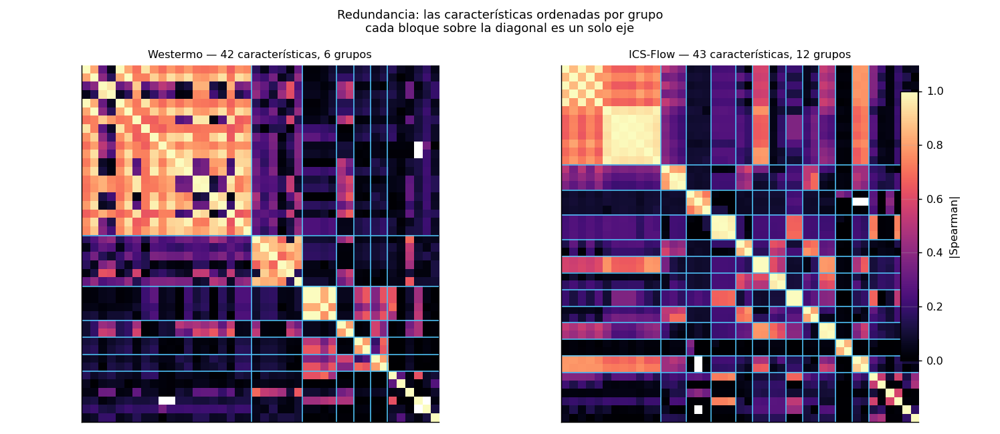
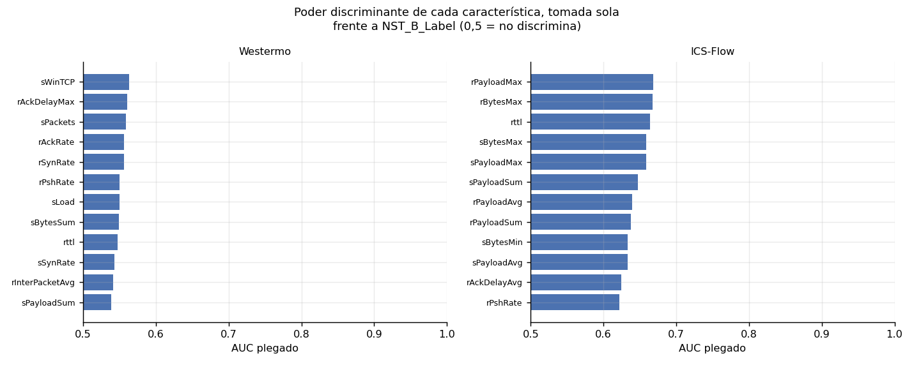
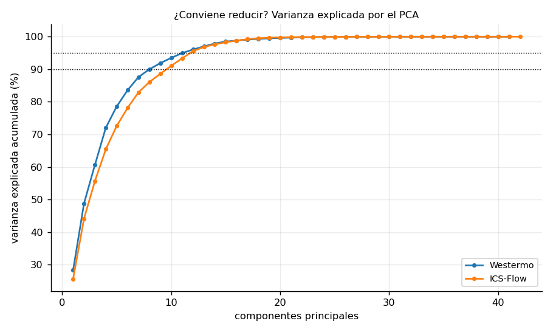
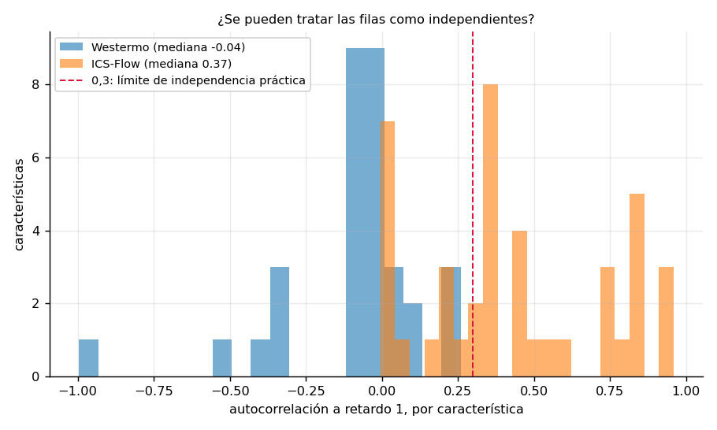
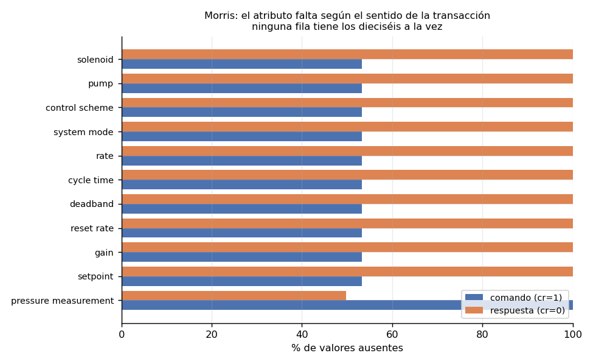
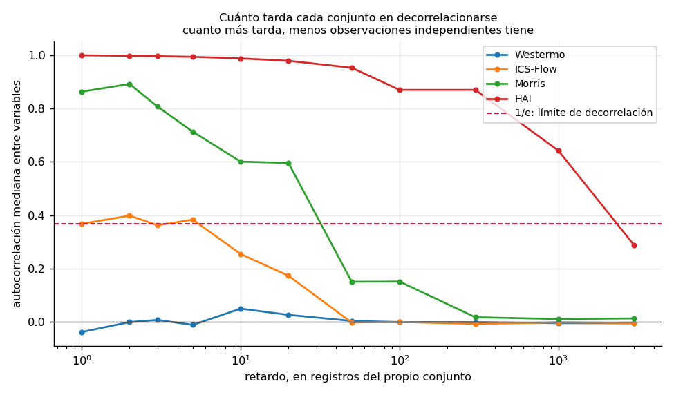

# Estudio exploratorio de los conjuntos de datos

Trabajo Final — Carrera de Especialización en Inteligencia Artificial, FIUBA.

Documento de trabajo. Describe qué contiene cada conjunto antes de cualquier
decisión de modelado, con el criterio de la materia Análisis de Datos.

Es complementario de `eda/INFORME.md`, que responde preguntas derivadas —si el
tráfico normal es determinista, si alcanzan las muestras, si los conjuntos se
pueden integrar—. Este describe los datos; aquel decide sobre ellos.

**Están los cinco conjuntos**, cada uno con su sección y el mismo guion:
qué es, qué falta, qué variables hay, cómo se distribuyen, cuánto discriminan,
qué estructura temporal tienen, si conviene reducir y cómo está el balance.
Donde una sección no aplica se dice por qué, en lugar de omitirla.

---

## Cómo se leyó cada conjunto

**Solo el tramo de entrenamiento.** El proyecto adoptó partición temporal
estricta y la regla de que ninguna decisión se tome con el conjunto de
prueba a la vista. Eso vale también para describir: un estudio exploratorio que mire el
test contamina el protocolo antes de empezar, y la descripción de las
distribuciones es la clase de información que condiciona las
decisiones posteriores.

| Conjunto | Tramo descrito | Registros | De un total de |
|---|---|---:|---:|
| Westermo | `startOffset` < 3265 s (60 %) | 21.080 | 35.404 |
| ICS-Flow | `start` < corte del 60 % | 25.620 | 45.718 |
| Morris | `time` < corte del 60 % | 163.823 | 274.628 |
| HAI (20.07) | los archivos `train` | 550.800 | — |
| QUT | los directorios `training/` | 42 PCAP | — |

De Westermo se describe el punto de captura inferior en su variante reducida,
que es el que usa el resto del trabajo. Se comprobó que los seis archivos del
conjunto —dos variantes por tres puntos de captura— tienen los mismos 64
campos en el mismo orden, con entre 4720 y 55.425 flujos cada uno.

Las cifras salen de `eda/scripts/16_exploratorio_flujos.py` y
`eda/scripts/17_discriminante_estructura.py`, con el reporte genérico de la
materia en `eda/derivados/reporte_westermo.md` y
`eda/derivados/reporte_icsflow.md`.

**Sobre la coherencia interna de los datos.** No se da por buena: el
inventario `eda/salidas/p10_inventario.txt` verifica dieciocho identidades
entre campos sobre cada archivo —que `duration` sea el intervalo declarado,
que los promedios sean el cociente de suma y cuenta, que el mínimo no supere
al máximo, que las catorce tasas caigan en [0, 1]— y se cumplen en el 100 %
de las filas, salvo `sLoad` y `rLoad` con un 0,06 % de desvío por redondeo.

---

## Lo que importa

Seis hallazgos antes del detalle, porque cambian cómo hay que prepararlos.

**1. Ninguna característica discrimina por sí sola.** El mejor AUC de una
característica tomada sola es **0,563 en Westermo** y **0,669 en ICS-Flow**,
contra el 0,5 de no discriminar. Ninguna de las 85 evaluadas entre los dos
conjuntos llega a 0,70. La detección tiene que ser multivariada; no hay un
indicador único que sirva de alarma.

**2. Y los dos conjuntos no son igual de difíciles.** La mejor combinación
lineal de todas las características separa con AUC **0,585 en Westermo** y
**0,993 en ICS-Flow**, las dos medidas sobre los mismos datos con que se
ajustaron, o sea cotas superiores. La diferencia es demasiado grande para ser
optimismo del ajuste: a nivel de características de flujo, Westermo es un
problema duro y ICS-Flow uno fácil.

**3. Los faltantes son estructurales, no aleatorios.** 38 de las 47
características tienen huecos, y en los dos conjuntos la ausencia se explica
por completo con ocho identidades exactas: el dato no está perdido, no existe.
Imputarlo sería inventar un número donde el protocolo no define ninguno.

**4. Las características son muchas menos de lo que parece.** Westermo declara
47; de ellas 5 son constantes y las demás se agrupan por correlación en
**12 ejes independientes**. ICS-Flow, en **18**. Un grupo de Westermo reúne
veinte características que se mueven juntas, y el PCA lo confirma: nueve y
diez componentes bastan para el 90 % de la varianza.

**5. Las filas de ICS-Flow no son independientes y las de Westermo sí.**
Dentro de una conversación, la autocorrelación mediana a retardo 1 es **0,37
en ICS-Flow** y **−0,04 en Westermo**. Las 25.620 filas de ICS-Flow valen como
11.848 a efectos de precisión, y cualquier validación cruzada sobre ese
conjunto tiene que ser por bloques temporales.

**6. El desbalance depende de una decisión, no del fenómeno.** La misma
captura da 1,7:1 o 4,8:1 en Westermo según qué estrategia de etiquetado se
elija. No es una propiedad del conjunto: es una elección de diseño que hay que
tomar antes de partir los datos.

---

## Westermo

### Qué es

Tráfico de una red industrial real de doce dispositivos, capturado en tres
puntos a la vez durante unos 90 minutos. Lo publica Westermo Network
Technologies bajo CC BY 4.0, que es el único de los conjuntos del trabajo con
licencia explícita y permisiva.

El registro es un **flujo de 0,5 segundos**: una fila resume medio segundo de
conversación entre dos direcciones, no un paquete. Las características las
calculó la herramienta ICSFlowGenerator a partir de los PCAP, que también se
publican.

- 21.080 flujos en el tramo de entrenamiento, 64 columnas
- 13 identificadores, 47 características, 4 etiquetas
- Sin filas duplicadas exactas; 2705 flujos (12,8 %) repiten los valores de
  las 47 características, lo que es esperable en tráfico periódico
- Protocolos: `IPV4-TCP` 17.750, `ARP` 1804, `IPV4-2` 1009, `LLDP` 324,
  `IPV4-UDP` 193

### Qué falta, y por qué

8,1 % de las celdas; 16,6 % de las filas tienen al menos un hueco. No es
azar. La hipótesis del dominio es que un flujo que no es TCP no tiene banderas
ni ventana, y que una dirección sin paquetes no tiene TTL que informar. Se
comprobó por identidad exacta, no por asociación:

| Campo | El valor falta si y solo si | ¿Se cumple? |
|---|---|---|
| `sttl`, `rttl` | el flujo no es TCP, o ese lado no tiene paquetes | sí |
| `sWinTCP`, `rWinTCP` | ídem | sí |
| `sAckRate`, `rAckRate` | ídem | sí |
| `sIPs`, `rIPs` | el protocolo no tiene capa IPv4 (`ARP`, `LLDP`) | sí |

Las ocho identidades se cumplen sin una sola excepción. El retardo de ACK
agrega una condición más, porque medir un retardo exige al menos dos paquetes:

| `sPackets` | Flujos | Sin `sAckDelayAvg` |
|---:|---:|---:|
| 0 | 88 | 100 % |
| 1 | 65 | 98 % |
| 2 | 28 | 29 % |
| 3 o más | 17.569 | 0 % |

**Qué hacer con esto.** No imputar. El reporte automático propone «imputación
simple» para las 21 columnas con más huecos, y sería un error: pondría una
media donde el protocolo no define ningún valor, y además borraría la
información de que el flujo no era TCP, que es informativa en sí misma. Lo que
corresponde es una bandera de ausencia, o separar el tratamiento por
protocolo.

### Qué variables hay en realidad

De las 47 características, **5 son constantes** —`sttl`, `sUrgRate`,
`rUrgRate`, `sFragmentRate`, `rFragmentRate`— y 6 más toman un mismo valor en
al menos el 99 % de las filas. Ninguna aporta a un modelo.

De las 42 no constantes, hay 83 pares con correlación de Spearman por encima
de 0,8. Agrupados por transitividad —si A va con B y B con C, las tres son el
mismo eje— quedan seis grupos:

| Grupo | Características | Qué mide |
|---|---:|---|
| 1 | 20 | volumen: bytes, paquetes, carga útil y ventana de los dos lados |
| 2 | 6 | temporizado: duración, retardo de ACK, intervalo entre paquetes, tasa |
| 3 | 4 | banderas de sincronización y TTL del receptor |
| 4 | 2 | máximo de bytes y de carga útil enviados |
| 5 | 2 | tasas de ACK y de reinicio del emisor |
| 6 | 2 | tasas de FIN de los dos lados |

**Las 47 características declaradas son 12 ejes independientes.** El grupo 1
solo reúne veinte columnas que se mueven juntas. Esto importa para cualquier
método que escale con la dimensión y para no leer como veinte evidencias lo
que es una sola.



*Las características están ordenadas por grupo, de modo que cada bloque claro
sobre la diagonal es un solo eje. El bloque grande de Westermo, arriba a la
izquierda, son las veinte columnas de volumen.*

### Cómo se distribuyen

Sobre las 42 no constantes: 4 simétricas, 5 de asimetría moderada y **33 de
asimetría alta**. Las más extremas son las de volumen y carga:

| Campo | Asimetría | Curtosis | Fuera del rango intercuartílico |
|---|---:|---:|---:|
| `sLoad` | 9,51 | 135,9 | 23,1 % |
| `rInterPacketAvg` | 1,14 | 12,6 | 20,0 % |
| `rLoad` | 85,38 | 8805,5 | 16,4 % |
| `sBytesAvg` | 8,37 | 77,7 | 8,4 % |

Con esas formas, la media no representa el centro: corresponde mediana, y
escala logarítmica si se escala.

**Sobre los valores extremos.** El 23,1 % de `sLoad` cae fuera del rango
intercuartílico, pero en tráfico de red un valor extremo rara vez es un error
de carga: es la ráfaga, el escaneo o el evento. Son el fenómeno a detectar. No
se eliminan, y conviene no tratarlos con un criterio automático.

### Poder discriminante

El requerimiento 2.8 pide documentar el poder discriminante de las
características, además de sus distribuciones y su periodicidad. Medido como
el AUC de cada una tomada sola frente a `NST_B_Label`, donde 0,5 es no
discriminar:

| Característica | AUC | AUC plegado | Información mutua |
|---|---:|---:|---:|
| `sWinTCP` | 0,563 | 0,563 | 0,026 |
| `rAckDelayMax` | 0,440 | 0,560 | 0,036 |
| `sPackets` | 0,442 | 0,558 | 0,013 |
| `rAckRate` | 0,444 | 0,556 | 0,023 |
| `rSynRate` | 0,556 | 0,556 | 0,015 |

El AUC plegado trata igual a las que discriminan con el signo invertido. De
las 42 evaluadas, **ninguna llega a 0,70 y 37 quedan por debajo de 0,55**. Con
el etiquetado `IT` el mejor cae a 0,515, casi el azar.

**Ninguna característica de flujo, por sí sola, separa el tráfico normal del
anómalo en Westermo.** Es un resultado negativo y es importante: descarta de
entrada cualquier regla de umbral sobre una variable, y obliga a que la
detección sea multivariada o se apoye en la estructura temporal y no en la
fila aislada.



*Las doce características con más poder discriminante en cada conjunto. La
línea en 0,5 es no discriminar. Ninguna barra llega a 0,70.*

### Estructura temporal

Las filas no son observaciones sueltas: pertenecen a una conversación que
avanza en el tiempo. Medida dentro de cada una de las siete conversaciones con
al menos 200 flujos, y ponderada por su largo:

| Retardo | Autocorrelación mediana | Características con \|ac\| > 0,3 |
|---:|---:|---:|
| 1 | −0,04 | 6 de 42 |
| 2 | −0,00 | 1 |
| 10 | 0,05 | 6 |

**Las filas sucesivas son casi independientes.** La corrección AR(1) del
tamaño de muestra es inmaterial, de modo que los estadísticos habituales se
pueden usar sin ajuste y una validación cruzada al azar no introduciría fuga
apreciable. Es lo contrario de lo que pasa en ICS-Flow.

### ¿Conviene reducir la dimensión?

PCA sobre las 41 características no constantes, estandarizadas, con las 17.586
filas completas (83 % del tramo; no se imputa, porque los faltantes son
estructurales).

- **9 componentes** para el 90 % de la varianza, **12** para el 95 %
- La primera explica el 28,3 %

Coincide con lo que dijo el análisis de redundancia por otro camino: doce ejes
independientes, nueve componentes para el 90 %. El conjunto es, de hecho, de unas
diez dimensiones y no de cuarenta y siete.



*Las líneas punteadas marcan el 90 % y el 95 % de la varianza. Los dos
conjuntos llegan al 90 % con nueve y diez componentes.*

El LDA, que busca la mejor dirección lineal para separar las clases, alcanza
**AUC 0,585** sobre los mismos datos con los que se ajustó. Es una cota
superior y aun así apenas supera el azar, lo que confirma el resultado del
poder discriminante: en Westermo la señal no está en una combinación lineal de
las características de flujo.

### Balance de clases

| Etiqueta | Normal | Anómalo | Razón |
|---|---:|---:|---:|
| `IT_B_Label` | 7852 | 13.228 | 1,7 : 1 |
| `NST_B_Label` | 17.456 | 3624 | 4,8 : 1 |

El mismo tramo de la misma captura da un problema distinto según la estrategia.
Con `IT` —que marca todo el tráfico mientras el ataque está activo— los
anómalos son **mayoría**. Con `NST` —que marca solo el tráfico que involucra
al atacante— son el 17 %. La diferencia por tipo es mayor todavía:

| Tipo | `IT_M_Label` | `NST_M_Label` |
|---|---:|---:|
| Normal | 7852 | 17.456 |
| BAD-SSH | 6727 | 229 |
| BAD-MITM | 2104 | 310 |
| BAD-MISCONF-DUPLICATION | 1494 | 1494 |
| BAD-MISCONF | 1413 | 1413 |
| BAD-PORTSCAN2 | 909 | 145 |
| BAD-PORTSCAN1 | 376 | 26 |
| GOOD-SSH | 205 | 7 |

Las dos malas configuraciones son idénticas bajo las dos estrategias, porque
no las produce un atacante sino el propio equipo mal configurado. Todo lo
demás cambia entre seis y veintinueve veces.

**Una advertencia sobre la fuga.** Un reporte automático marca `NST_M_Label`
como posible fuga de la target `NST_B_Label`, con asociación 1,00. No lo es:
son la misma variable, una binaria y otra multiclase. Las cuatro columnas son
la variable a predecir, y elegir entre `IT` y `NST` es una decisión de diseño,
no una característica disponible al momento de predecir. La fuga real sería
usar una estrategia como característica para predecir la otra.

---

## ICS-Flow

### Qué es

Tráfico de un banco de pruebas emulado de una planta embotelladora, con dos
PLC y varias interfaces de operador, más los registros de las variables de
proceso. Lo publica el mismo grupo que la herramienta ICSFlowGenerator, y por
eso **su esquema es idéntico al de Westermo**: los mismos 64 campos en el
mismo orden.

Se distribuye con licencia **CC BY-NC-SA 4.0**, que prohíbe el uso comercial y
obliga a licenciar los derivados igual. Es una diferencia importante respecto
de Westermo y conviene tenerla presente antes de que el conjunto entre en algo
que se entregue fuera del ámbito académico.

- 25.620 flujos en el tramo de entrenamiento, 64 columnas
- Sin duplicados exactos; 334 flujos (1,3 %) repiten los valores de las
  características, diez veces menos que en Westermo
- Protocolos: `IPV4-TCP` 24.878, `ARP` 643, `IPV4-ICMP` 81, `IPV4-UDP` 9,
  `IPV6` 9

El tráfico es mucho más homogéneo que el de Westermo: el 97 % es TCP, contra
el 84 % allá.

### Qué falta, y por qué

1,6 % de las celdas y 7,0 % de las filas, bastante menos que en Westermo, y
por la misma razón estructural. Las mismas ocho identidades se cumplen
exactas, con una diferencia que conviene registrar: **el conjunto de
protocolos sin IPv4 no es el mismo**.

| Campo | El valor falta si y solo si | ¿Se cumple? |
|---|---|---|
| `sttl`, `rttl`, `sWinTCP`, `rWinTCP`, `sAckRate`, `rAckRate` | no es TCP, o ese lado no tiene paquetes | sí |
| `sIPs`, `rIPs` | el protocolo no tiene capa IPv4 (`ARP`, `IPV6`) | sí |

En Westermo esos protocolos son `ARP` y `LLDP`; acá son `ARP` e `IPV6`. La
regla es la misma —no hay dirección IPv4 que informar— pero el repertorio
cambia, de modo que no se puede codificar la lista: hay que derivarla de cada
conjunto. Es el tipo de detalle que convierte un lector común en uno que falla
en silencio.

### Qué variables hay en realidad

**4 constantes** —`sUrgRate`, `rUrgRate`, `sFragmentRate`, `rFragmentRate`— y
5 casi constantes. De las 43 restantes, 46 pares superan el umbral de
correlación y se agrupan en doce grupos, que dejan **18 ejes independientes**.

Hay seis más que en Westermo, y el motivo es interesante: en Westermo el gran
grupo de volumen absorbe veinte características, mientras que acá se parte en
varios grupos chicos —`sBytesSum` con `sPackets`, `rBytesSum` con `rPackets`,
`rPayloadSum` con `sPayloadSum`—. En un banco emulado las direcciones de envío
y recepción se mueven con más independencia que en una red real.

### Cómo se distribuyen

4 simétricas, 4 moderadas y **35 de asimetría alta**, un cuadro muy parecido al
de Westermo.

| Campo | Asimetría | Curtosis | Fuera del rango intercuartílico |
|---|---:|---:|---:|
| `sLoad` | 14,09 | 238,4 | 24,1 % |
| `rLoad` | 17,08 | 301,3 | 23,6 % |
| `duration` | −1,20 | −0,4 | 22,4 % |
| `rPackets` | 6,98 | 50,9 | 9,7 % |

`duration` es el único caso de asimetría negativa marcada: se acumula contra
el techo de 0,5 s de la ventana, de modo que la cola se extiende hacia los
flujos cortos. Es un artefacto de cómo se construye el flujo, no del tráfico.

### Poder discriminante

| Característica | AUC | AUC plegado | Información mutua |
|---|---:|---:|---:|
| `rPayloadMax` | 0,331 | 0,669 | 0,008 |
| `rBytesMax` | 0,333 | 0,667 | 0,007 |
| `rttl` | 0,336 | 0,664 | 0,043 |
| `sBytesMax` | 0,341 | 0,659 | 0,008 |
| `sPayloadSum` | 0,353 | 0,647 | 0,153 |

De las 43 evaluadas, **tampoco ninguna llega a 0,70**, pero solo 18 quedan por
debajo de 0,55 —contra 37 en Westermo—. Hay más señal repartida, aunque
ninguna variable sola alcance.

Vale la pena mirar `sPayloadSum`: su AUC plegado es 0,647 pero su información
mutua es 0,153, la más alta del conjunto y seis veces la de `rBytesMax`, que
tiene AUC parecido. La información mutua captura relaciones no monótonas que
el AUC se pierde, de modo que esa característica separa las clases sin que
una sea siempre mayor que la otra.

### Estructura temporal

| Retardo | Autocorrelación mediana | Características con \|ac\| > 0,3 |
|---:|---:|---:|
| 1 | 0,37 | 27 de 43 |
| 2 | 0,40 | 26 |
| 10 | 0,25 | 17 |

**Las filas no se pueden tratar como independientes.** Con una autocorrelación
mediana de 0,37 a retardo 1 y todavía 0,25 diez flujos después, la corrección
AR(1) deja las 25.620 filas en un equivalente de **11.848**, el 46 %.

Esto tiene dos consecuencias prácticas. Cualquier validación cruzada sobre
este conjunto tiene que ser **por bloques temporales**: con particiones al
azar, el vecino de una fila de validación está en el conjunto de ajuste y casi
en el mismo estado. Y todo intervalo de confianza calculado como si las filas
fueran independientes sale demasiado angosto, lo que alcanza a los intervalos
de PD de [`INFORME.md`](INFORME.md).

La dispersión entre conversaciones es grande: la más larga llega a 0,82 de
autocorrelación mediana, bastante por encima del 0,37 ponderado. El número que
corresponde usar es el ponderado.



*Westermo se concentra alrededor de cero y ICS-Flow se extiende hasta 0,95. La
línea marca 0,3; por encima de ese valor las filas dejan de poder tratarse
como independientes.*

### ¿Conviene reducir la dimensión?

PCA sobre las 42 características no constantes, con las 23.828 filas completas
(93 % del tramo).

- **10 componentes** para el 90 % de la varianza, **12** para el 95 %
- La primera explica el 25,6 %

El LDA alcanza **AUC 0,993** sobre los datos de ajuste. Es una cota superior,
y además optimista por partida doble, porque el tamaño de muestra efectivo es
la mitad del nominal. Pero la distancia con el 0,585 de Westermo es demasiado
grande para atribuirla al optimismo: **a nivel de características de flujo,
ICS-Flow es un problema mucho más fácil que Westermo.**

Conviene tenerlo presente al leer cualquier resultado que se obtenga sobre
ICS-Flow: una métrica alta ahí no anticipa la misma métrica sobre tráfico
real.

### Balance de clases

| Etiqueta | Normal | Anómalo | Razón |
|---|---:|---:|---:|
| `IT_B_Label` | 21.006 | 4614 | 4,6 : 1 |
| `NST_B_Label` | 22.856 | 2764 | 8,3 : 1 |

| Tipo | `IT_M_Label` | `NST_M_Label` |
|---|---:|---:|
| Normal | 21.006 | 22.856 |
| replay | 1855 | 1051 |
| port-scan | 952 | 574 |
| mitm | 942 | 807 |
| ddos | 541 | 244 |
| ip-scan | 324 | 88 |

El desbalance es mayor que en Westermo con las dos estrategias, y la brecha
entre `IT` y `NST` es menor: acá va de 4,6:1 a 8,3:1, mientras que allá iba de
1,7:1 a 4,8:1. El motivo es que los eventos de ICS-Flow ocupan una fracción
menor de la captura.

---

## Morris / Turnipseed

### Qué es

Registros de un gasoducto de laboratorio del Mississippi State SCADA Lab, en
su versión corregida. **No es tráfico de red**: cada fila es una transacción
Modbus con los campos ya extraídos por terceros, de modo que no hay captura y
no se pueden recalcular las características.

- 163.823 transacciones en el tramo de entrenamiento, de 274.628 en total
- 20 atributos: uno de tiempo, 16 características y 3 etiquetas
- Sin licencia declarada; recuperado del Internet Archive

### Qué falta, y por qué

Faltan tres de cada cuatro valores en once de los dieciséis atributos: el
76,6 % en los del lazo de control y el 74,9 % en `pressure measurement`. Es la
proporción más alta de los cuatro conjuntos, y también es estructural.

| Atributo | Nulos si `cr` = 1 (comando) | Nulos si `cr` = 0 (respuesta) |
|---|---:|---:|
| `pressure measurement` | 100 % | 50 % |
| `setpoint` | 53 % | 100 % |
| `gain` | 53 % | 100 % |

Una petición no trae medición y una respuesta no trae consigna. La mitad que
queda dentro de cada sentido corresponde al código de función: solo las
escrituras llevan parámetros del lazo y solo las lecturas devuelven presión.

La consecuencia es más fuerte que en los conjuntos de flujo: **ninguna fila
tiene los dieciséis atributos a la vez**. Cero de 163.823. Petición y
respuesta son disjuntas por construcción, de modo que cualquier método que
exija filas completas se queda sin datos.



*Cada atributo falta por completo en uno de los dos sentidos. Los del lazo de
control solo existen en comandos y la presión solo en respuestas, de modo que
las dos mitades no se superponen.*

### Qué variables hay en realidad

Ninguna constante y **ningún par con correlación por encima de 0,8**. Es lo
contrario de los conjuntos de flujo, donde un solo grupo reunía veinte
columnas: acá los atributos son de naturaleza distinta —consigna, ganancia,
modo de sistema, código de función— y se mueven por separado. Los dieciséis
son dieciséis ejes.

### Cómo se distribuyen

3 simétricas, 4 de asimetría moderada y 9 de asimetría alta. Menos sesgado que
los conjuntos de flujo, donde la proporción alta pasaba del 78 %.

### Poder discriminante

| Atributo | AUC | AUC plegado | n |
|---|---:|---:|---:|
| `pressure measurement` | 0,316 | **0,684** | 41.085 |
| `crc rate` | 0,611 | 0,611 | 163.823 |
| `command response` | 0,394 | 0,606 | 163.823 |
| `function` | 0,604 | 0,604 | 163.823 |
| `setpoint` | 0,553 | 0,553 | 38.398 |

El mejor es 0,684, apenas por encima del 0,669 de ICS-Flow y bastante por
encima del 0,563 de Westermo. Que Morris quede primero es esperable, porque
sus atributos son semánticos y la anomalía los manipula de forma directa.
Pero la diferencia es de centésimas: **en ninguno de los tres conjuntos con
etiqueta hay un atributo que separe bien por sí solo.**

### Estructura temporal

Es una sola secuencia de transacciones, no varias conversaciones en paralelo.

| Retardo | Autocorrelación mediana | Atributos con \|ac\| > 0,3 |
|---:|---:|---:|
| 1 | 0,86 | 11 de 16 |
| 5 | 0,71 | 11 |
| 10 | 0,60 | 12 |

Con 0,86 a retardo 1, las 163.823 transacciones equivalen a **12.060**, el
7 %. El lazo de control repite el mismo ciclo, así que vale la advertencia de
ICS-Flow: validación por bloques y nunca al azar.

### ¿Conviene reducir la dimensión?

**No se calcula el PCA**, y el motivo es el de más arriba: no hay ninguna fila
con los dieciséis atributos. Un análisis sobre filas completas describiría un
subconjunto vacío. Si se quisiera reducir, habría que hacerlo por separado
para peticiones y para respuestas, que son dos poblaciones con atributos
distintos.

### Balance de clases

128.457 normales y 35.366 ataques en el tramo, razón 3,6 : 1. Es el único de
los cinco con una **taxonomía de anomalías contextuales etiquetada** —MPCI,
CMRI, MSCI, MFCI— y por eso es el que sostiene el compromiso de medir PD por
tipo.

---

## HAI

### Qué es

Series de proceso de un banco de pruebas de generación térmica e hidráulica,
muestreadas a 1 Hz. **No trae ni una característica de red**: todas sus
columnas son variables físicas, en bar, mm, l/h, %, grados, RPM, MW y Hz.

Son cinco versiones que no comparten esquema entre sí:

| Versión | Archivos de entrenamiento | Columnas | Filas | Horas |
|---|---:|---:|---:|---:|
| hai-20.07 | 2 | 64 | 550.800 | 153 |
| hai-21.03 | 3 | 84 | 921.603 | 256 |
| hai-22.04 | 6 | 88 | 1.004.402 | 279 |
| hai-23.05 | 4 | 87 | 896.400 | 249 |
| haiend-23.05 | 4 | 226 | 896.400 | 249 |

La ficha se hace sobre **hai-20.07**, que es la versión con línea base
publicada y la que el proyecto tomó de referencia.

### Qué falta, y por qué

No falta nada: el máximo de nulos en cualquier columna es 0,00 %. Es lo
esperable de un registro de proceso que muestrea a intervalo fijo. Es el único
de los cuatro conjuntos medidos sin faltantes.

### Qué variables hay en realidad

De las 59 columnas de proceso, **8 son constantes** en todo el tramo —el 14 %,
la firma de un banco donde parte de los lazos queda en reposo— y entre las 51
restantes hay 74 pares con correlación por encima de 0,8.

### Cómo se distribuyen

30 simétricas, 10 moderadas y 11 de asimetría alta. Es el cuadro opuesto al de
los conjuntos de flujo, donde cuatro de cada cinco características eran muy
asimétricas. Las variables de proceso oscilan alrededor de su consigna; las de
tráfico se acumulan contra el cero.

### Poder discriminante: no se puede medir

**Los archivos de entrenamiento de HAI no traen anomalías.** En esta versión
hay 776 filas con etiqueta distinta de cero sobre 550.800, y son los dos
ataques que se colaron en `train2` y que [`INFORME.md`](INFORME.md) ya había
detectado. Con una clase positiva de ese tamaño no se puede estimar el poder
discriminante de nada.

Es una diferencia de diseño respecto de Westermo, ICS-Flow y Morris, que sí
traen anomalías etiquetadas dentro del tramo de entrenamiento. Medirlo sobre
el tramo de prueba daría el número, pero rompería el protocolo: **queda sin
medir, y se deja dicho en lugar de completarlo.**

### Estructura temporal

| Retardo | Autocorrelación mediana | Columnas con \|ac\| > 0,3 |
|---:|---:|---:|
| 1 | 1,00 | 46 de 51 |
| 5 | 0,99 | 48 |
| 10 | 0,99 | 48 |

Es **el valor más alto de los cuatro conjuntos**, y tan cerca de 1 que la
corrección AR(1) deja de ser fiable: su resultado cambia de orden de magnitud
con la cuarta cifra de la autocorrelación. Se usa en su lugar el tiempo de
decorrelación, el retardo en que la autocorrelación cae por debajo de 1/e,
que no supone ningún modelo:

- Tiempo de decorrelación mediano: **1800 s**, media hora
- Muestras independientes equivalentes: **≈ 306** sobre 550.800

Las 153 horas de registro valen como unas trescientas observaciones
independientes. Es la cifra que hay que usar para cualquier intervalo de
confianza sobre este conjunto, y cambia por completo la lectura de su tamaño.



*La autocorrelación de HAI sigue por encima de 0,9 cien registros después y
solo cruza el umbral de 1/e cerca de los tres mil. Westermo arranca en cero.
Entre esas dos curvas está la diferencia entre tener muchas observaciones y
tener muchas filas.*

### ¿Conviene reducir la dimensión?

PCA sobre las 51 columnas no constantes, con las 550.800 filas completas.

- **13 componentes** para el 90 % de la varianza, **17** para el 95 %
- La primera explica el 24,8 %

### Balance de clases

No aplica en el tramo de entrenamiento, por lo dicho más arriba. El recuento
de ataques por versión, sobre los archivos de prueba y solo como conteo, está
en la pregunta 4 de `eda/INFORME.md`.

---

## QUT DNP3

### Qué es

Capturas de un banco de pruebas DNP3 con siete escenarios, cada uno partido en
entrenamiento y prueba por los propios autores. **Es el único de los cinco que
no publica ninguna tabla de características**, de modo que casi todas las
secciones de esta ficha no tienen con qué completarse.

Del tramo de entrenamiento:

| Tipo de archivo | Archivos | En disco |
|---|---:|---:|
| PCAP (`master`, `slave`, `attacker`) | 42 | 3713 MB |
| `master.csv` / `slave.csv` | 24 | 9,5 MB |
| `tshark/*.csv` | 180 | 115 MB |

### Qué variables hay: ninguna publicada

Los PCAP no traen cabecera ni esquema. Todo lo que el proyecto usa de ellos lo
calcula su propio lector, y eso está documentado en la pregunta 1 de
`eda/INFORME.md`. **Las características de QUT son una decisión del proyecto,
no un dato del conjunto**, que es la razón por la que el proyecto lo eligió
para construir el flujo de extracción.

Los `master.csv` y `slave.csv` son CSV **sin cabecera**, de tres campos, y solo
contienen los paquetes de ataque: 94.377 filas con 32 etiquetas distintas. El
escenario `Control`, que es la línea base sin ataque, no tiene esos archivos.

### Lo que no se puede decir todavía

Faltantes, distribuciones, redundancia, poder discriminante y reducción **no
se pueden evaluar**, porque no hay variables sobre las que evaluarlos. No es
una omisión de este estudio: es la consecuencia de que el conjunto publique
capturas y no una tabla.

Lo que sí está medido sobre sus PCAP, en la pregunta 1 y en la sección 4 de
`eda/INFORME.md`, es la estructura del protocolo: 2.372.794 tramas DNP3 sin un
solo error de CRC, el repertorio de códigos de función y el emparejamiento de
comando y respuesta. El inventario de archivos está en
`eda/salidas/p10_inventario.txt`, sección E.

Cuando el proyecto calcule las características de flujo sobre estos PCAP,
corresponderá rehacerle esta ficha con el mismo guion que a Westermo e
ICS-Flow.

---

## Los cinco juntos

| | Westermo | ICS-Flow | Morris | HAI (20.07) | QUT |
|---|---:|---:|---:|---:|---:|
| Unidad del registro | flujo 0,5 s | flujo 0,5 s | transacción | proceso 1 s | paquete |
| Registros de entrenamiento | 21.080 | 25.620 | 163.823 | 550.800 | — |
| Variables publicadas | 47 | 47 | 16 | 59 | **0** |
| Celdas faltantes | 8,1 % | 1,6 % | **~75 %** | 0 % | — |
| Variables constantes | 5 | 4 | 0 | 8 | — |
| Componentes para el 90 % | 9 | 10 | no aplica | 13 | — |
| Asimetría alta | 33 de 42 | 35 de 43 | 9 de 16 | 11 de 51 | — |
| Autocorrelación a retardo 1 | **−0,04** | 0,37 | 0,86 | **1,00** | — |
| Observaciones independientes | ≈ 21.080 | 11.848 | 12.060 | **≈ 306** | — |
| Mejor AUC de una variable | 0,563 | 0,669 | **0,684** | no medible | — |
| Anomalías en entrenamiento | sí | sí | sí | **no** | sí |
| Licencia | CC BY 4.0 | CC BY-NC-SA 4.0 | sin declarar | CC BY-SA 4.0 | sin declarar |

**Las licencias están verificadas en su fuente, una por una**, y no tomadas
de la ficha del repositorio: el archivo `LICENSE` de Westermo, las páginas de
Kaggle de ICS-Flow y de HAI, y la ausencia de todo archivo de términos en
Morris y en QUT. Dos merecen atención si el desarrollo se entrega: ICS-Flow
prohíbe el uso comercial, y tanto ICS-Flow como HAI obligan a licenciar los
derivados en los mismos términos. Morris y QUT no conceden derechos de forma
explícita, que para una entrega es más incómodo que una cláusula restrictiva.

Tres lecturas que solo aparecen al poner los cinco en la misma tabla.

**El tamaño nominal engaña.** HAI parece el conjunto más grande con 550.800
muestras y es el más chico en observaciones independientes: unas trescientas.
Westermo parece el más chico y es el único cuyas filas resultan
independientes. Ordenar los conjuntos por número de filas da el orden
equivocado.

**Ninguna variable alcanza sola, en ninguno.** El mejor AUC de los tres
conjuntos donde se puede medir va de 0,563 a 0,684. No hay un indicador único
que sirva de alarma en ninguna de las tres fuentes, y eso es un resultado
sobre el problema y no sobre los datos.

**Los faltantes y la dimensión se comportan al revés de lo esperable.** El
conjunto con atributos semánticos —Morris— es el que más valores omite, el
75 %, y a la vez el único sin ninguna redundancia entre variables. Los de
flujo, con casi todas las celdas llenas, resultan ser una docena de ejes
disfrazados de cuarenta y siete columnas.

Para la comparación entre Westermo e ICS-Flow en particular: comparten el
esquema, la ventana de 0,5 s y el repertorio de etiquetas, y difieren en la
homogeneidad. Esa diferencia está medida aparte, en la sección 5 de
`eda/INFORME.md`: aunque el esquema sea idéntico, las distribuciones del
tráfico normal difieren por encima de la variabilidad interna de cada uno, y
lo hacen en las características de volumen y temporizado.

---

## Qué implica para la preparación

Esto no es una lista de decisiones tomadas —el trabajo todavía no modela—,
sino lo que la descripción deja fijado.

1. **No imputar los faltantes estructurales.** Corresponde una bandera de
   ausencia, o separar el tratamiento por protocolo. Imputar con la media,
   que es lo que sugiere un reporte automático, destruiría información y
   fabricaría valores inexistentes.
2. **Descartar las degeneradas antes de cualquier cálculo**: 5 constantes en
   Westermo y 4 en ICS-Flow, más las casi constantes según el umbral que se
   adopte.
3. **Usar mediana y considerar escala logarítmica**, porque entre el 78 % y el
   81 % de las características tienen asimetría alta.
4. **No tratar los valores extremos como errores.** Son el fenómeno a
   detectar.
5. **Tener en cuenta la redundancia al elegir características.** Doce y
   dieciocho ejes, no cuarenta y siete columnas. Una selección por filtros que
   mire cada columna por separado va a quedarse con varias del mismo grupo.
6. **Elegir la estrategia de etiquetado antes de partir los datos**, porque
   define el problema. El trabajo adoptó `NST`; vale la pena reportar `IT` en
   paralelo como cota.
7. **Respetar la estructura temporal al partir.** Son series en el tiempo con
   eventos que duran más que un flujo, así que el corte va por tiempo y no al
   azar. Ya está fijado así, y con un recaudo que conviene no perder: **las
   filas no vienen ordenadas por tiempo en los archivos**, de modo que el
   corte se hace por el valor de la columna y nunca por la posición de la
   fila.
8. **Validación cruzada por bloques en ICS-Flow.** Con autocorrelación de
   0,37, una partición al azar deja el vecino de cada fila de validación
   dentro del ajuste. En Westermo el riesgo es despreciable.
9. **Ensanchar los intervalos de ICS-Flow.** Su tamaño de muestra efectivo es
   el 46 % del nominal, así que cualquier intervalo calculado como si las
   filas fueran independientes queda angosto por un factor de alrededor de
   1,5.
10. **No confundir el valor extremo con la anomalía.** El rango
   intercuartílico mira la distribución marginal e ignora el tiempo. Una
   anomalía contextual —la familia que más le importa a este proyecto— es un valor
   corriente en su marginal y raro **dado su contexto**. Las dos cosas no se
   superponen, y los outliers de la sección anterior no son la lista de
   anomalías.
11. **No esperar que una sola variable alcance.** Ninguna característica llega
   a 0,70 de AUC en ninguno de los dos conjuntos, y en Westermo la mejor
   combinación lineal queda en 0,585. Cualquier línea base que dependa de un
   umbral sobre una variable va a fallar.
12. **Sobre reducir la dimensión.** Nueve y diez componentes bastan para el
   90 % de la varianza, de modo que el PCA comprime bien. Pero comprime sin
   mirar la etiqueta, y con la señal tan repartida conviene no descartar
   componentes de varianza baja sin comprobar antes que no son las que
   discriminan.

---

## Sobre los datos sensibles

Los dos conjuntos publican seis columnas con identificadores de red:
direcciones, MAC e IP de origen y destino. En Westermo hay entre 7 y 27
valores distintos según la columna, y en ICS-Flow entre 6 y 14.

No son datos personales: son equipos de un banco de pruebas, con
direccionamiento no enrutable en Internet, y los autores de Westermo declaran
haber filtrado tráfico antes de publicar para proteger a la empresa. Pero sí
son **topología**: el conjunto de direcciones y la matriz de quién habla con
quién describen la red. Conviene no reproducirlas en un anexo sin pensarlo, y
tenerlo presente si alguna vez se aplica el mismo procedimiento a una captura
de una red en producción, donde la consideración ya no sería la misma.

---

## Cómo reproducir

```bash
make -C eda exploratorio
```

O paso a paso, desde la raíz del repositorio:

```bash
eda/.venv/bin/python -I eda/scripts/16_exploratorio_flujos.py
eda/.venv/bin/python -I eda/scripts/17_discriminante_estructura.py
eda/.venv/bin/python -I eda/scripts/18_exploratorio_resto.py
```

El segundo usa scikit-learn, que se agregó a `eda/.venv` para no escribir a
mano el AUC, la información mutua, el PCA y el LDA: así un revisor audita un
parámetro y no un cálculo. Está en `eda/requirements.txt` con su versión.

**Una advertencia sobre el entorno.** numpy compilado contra Accelerate, que
es lo que trae macOS, emite avisos de desbordamiento en `matmul` durante el
PCA. No afectan al resultado: se comprobó que la varianza explicada da lo
mismo por tres caminos —scikit-learn, autovalores de la covarianza y
descomposición en valores singulares— con una diferencia máxima de 10⁻¹⁵. El
script los silencia y deja dicho el motivo.

El reporte genérico de la materia, sobre los derivados del tramo de
entrenamiento:

```bash
eda/.venv/bin/python -I ~/.claude/skills/analisis-de-datos/scripts/eda_report.py \
  eda/derivados/westermo_bottom_entrenamiento.csv --target NST_B_Label \
  --out eda/derivados/reporte_westermo.md
```

Los derivados del tramo de entrenamiento los escribe el propio script en
`eda/derivados/`, que no se versiona. Todo corre en `eda/.venv`; el script de
la materia solo necesita pandas y numpy, que ya están ahí, de modo que no hace
falta instalar nada aparte.
