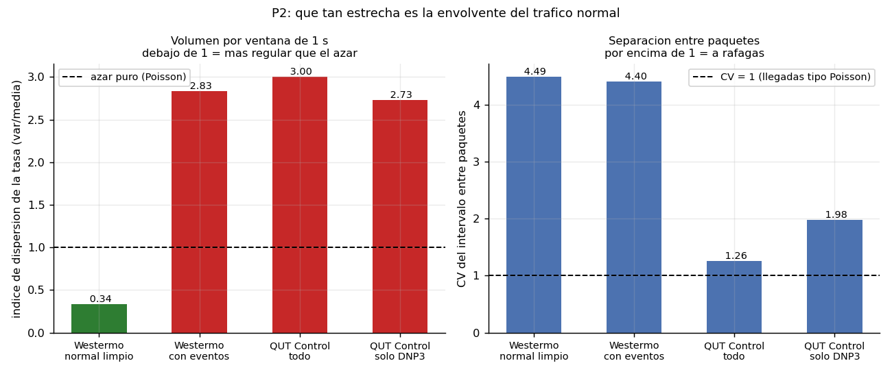
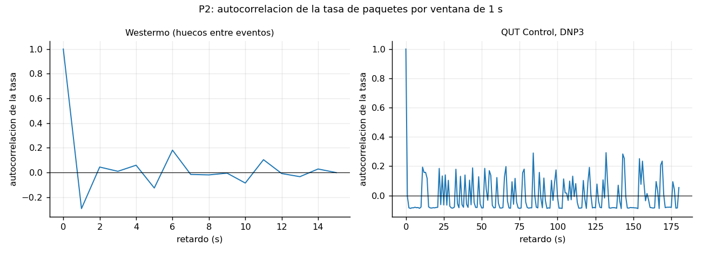
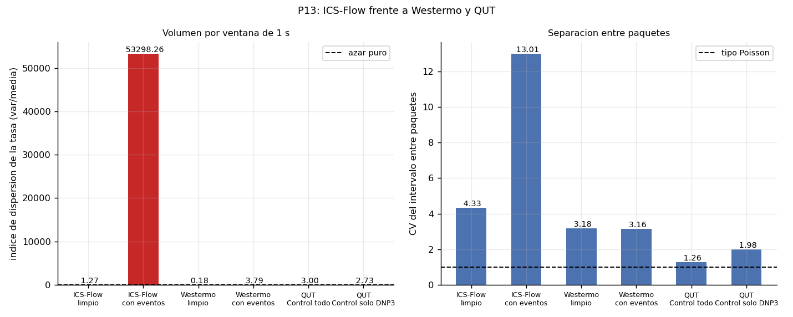
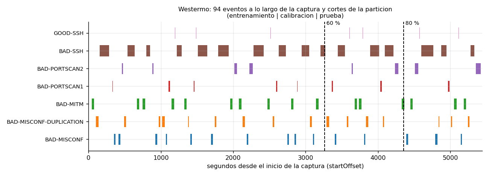
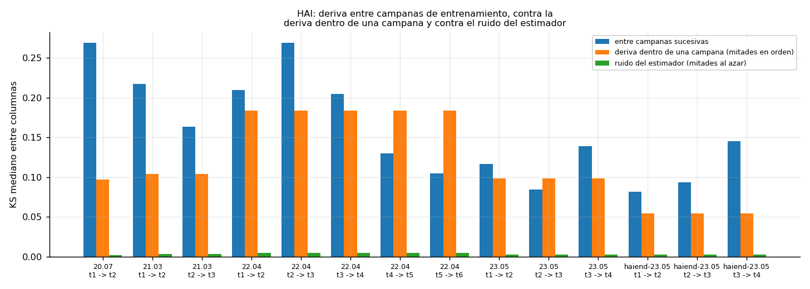
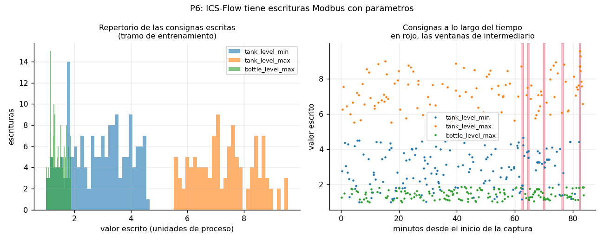
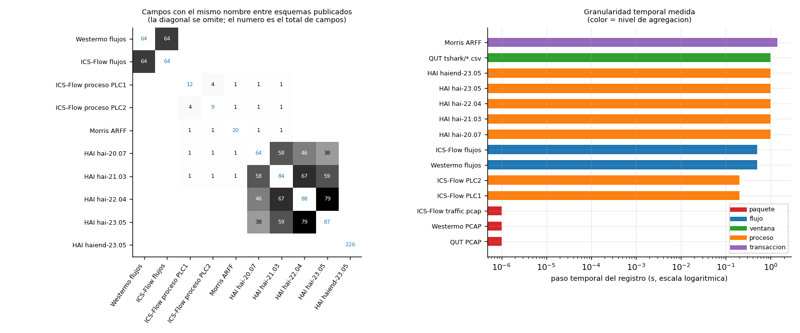

# Análisis exploratorio de los conjuntos de datos

Trabajo Final — Carrera de Especialización en Inteligencia Artificial, FIUBA.
Tarea 3 del plan de trabajo, requerimiento 2.8.

24 de octubre de 2026.

Todas las cifras de este informe salen de correr los scripts de `eda/scripts/`
sobre los archivos de `datasets/`. Las salidas completas quedan en
`eda/salidas/` y las figuras en `eda/figuras/`. Donde un dato **no** se pudo
verificar contra los archivos, se deja dicho.

**Este es el segundo de los dos documentos del análisis exploratorio.** El
primero es [`EXPLORATORIO.md`](EXPLORATORIO.md), que describe qué contiene
cada conjunto —variables, tipos, faltantes, redundancia, poder discriminante,
estructura temporal y balance— con una sección por conjunto. Conviene leerlo
antes que este, que no describe los datos sino que responde preguntas sobre
ellos y sobre la selección de conjuntos que el proyecto traía propuesta.

**Qué es «la selección previa» en estas páginas.** El relevamiento del estado
del arte de este Trabajo Final dejó elegidos cinco conjuntos y una tabla de
criterios de comparabilidad, D1 a D7, con un símbolo por conjunto y criterio.
Esa selección se escribió a partir de la documentación publicada de cada
conjunto, antes de abrir un solo archivo. Este análisis la contrasta contra
los datos: cuando una medición la contradice, el texto lo dice y da el número.
Esos documentos previos no forman parte de este repositorio; todo lo que de
ellos se contrasta está transcrito acá, al lado de la medición.

---

## 1. Nueve hallazgos que cambian cómo se usan estos conjuntos

Van primero porque son el resultado más importante del análisis. Seis
contradicen lo que la documentación de los propios conjuntos, la literatura o
la selección previa dan por sentado —§1.1 a §1.5 y §1.8—, uno corrige los
contadores que un conjunto publica —§1.7— y dos corrigen conclusiones de este
mismo análisis —§1.6 y §1.9—. Cada uno está medido sobre los archivos.

### 1.1 `master.pcap` y `slave.pcap` no separan comando de respuesta

QUT DNP3 publica cada escenario en dos capturas, `master.pcap` y
`slave.pcap`, y `datasets/LEEME.md` lo describía como que esa separación
entrega la distinción entre comando y respuesta sin necesidad de emparejar
nada. **No es así.**

Medido sobre los 14 escenarios de entrenamiento, cada uno de los dos archivos
contiene las dos direcciones del diálogo, en proporciones casi idénticas:

| Escenario (training) | master: lado maestro / lado esclavo | slave: lado maestro / lado esclavo |
|---|---|---|
| Control / frequent | 34.800 / 32.373 (51,8 %) | 34.800 / 32.373 (51,8 %) |
| Injection / frequent | 35.242 / 32.703 (51,9 %) | 35.048 / 32.834 (51,6 %) |
| Replay / frequent | 34.934 / 32.375 (51,9 %) | 35.427 / 32.732 (52,0 %) |

El reparto es por **dirección del diálogo** y no por petición contra
respuesta, y conviene decirlo porque el corte está en el código de función:
menor que 128 cuenta del lado maestro, lo que pone ahí también los CONFIRM
—5706 de los 34.800 de `Control / frequent`—. Un CONFIRM no lleva respuesta
por diseño, de modo que para la tasa de emparejamiento hace falta la otra
definición, que es la que usa la pregunta 1. Para lo que esta sección afirma
da igual, porque el CONFIRM lo manda el maestro.

En los 28 pares medidos la proporción del lado maestro cae siempre entre
51,0 % y 55,9 %. No hay ningún archivo que contenga solo comandos ni ninguno
que contenga solo respuestas. En el escenario `Control` las dos capturas registran
**la misma conversación, tramo por tramo**: la secuencia de pares (código de
función, número de secuencia) coincide en 20.000 de 20.000 tramas comparadas.
Son dos puntos de captura del mismo enlace, no una partición por rol.

**Qué hacer con esto.** La separación entre comando y respuesta sí se puede
obtener, pero del propio código de función DNP3 —1 para `READ` frente a 129
para `RESPONSE`— y de la dirección de enlace. El emparejamiento por número de
secuencia funciona y cubre el 100 % de las lecturas (pregunta 1). El conjunto
sirve; lo que no sirve es confiar en los nombres de archivo.

### 1.2 QUT DNP3 no contiene comandos de control con parámetros

Sobre las 2.318.092 cabeceras de objeto DNP3 extraídas de los 42 PCAP
agregados del tramo de entrenamiento —el 53,4 % del árbol por volumen; el
resto son capturas por episodio que, por lo que se pudo muestrear, repiten el
mismo tráfico (§3, pregunta 1)—, **no aparece ni un solo objeto de control**:

| Objeto | Qué es | Apariciones |
|---|---|---:|
| g12v1 (CROB) | comando de salida binaria, con código de control, duración y repeticiones | **0** |
| g41 (Analog Output Block) | consigna analógica | **0** |
| g40 (estado de salida analógica) | realimentación de consigna | **0** |

Lo que sí aparece es sondeo por clase y telemetría:

| Objeto | Apariciones | Objeto | Apariciones |
|---|---:|---|---:|
| g60v2/v3/v4 (clases 1/2/3) | 1.245.413 | g80v1 (indicaciones internas) | 152.896 |
| g1v2 (entrada binaria) | 230.291 | g20v0/g20v2 (contadores) | 296.759 |
| g60v1 (clase 0) | 175.161 | g2v1 (evento de entrada binaria) | 162.616 |
| g50v3 (marca de tiempo) | 54.902 | g52v2 (retardo) | 54 |

Las 207.798 operaciones `WRITE` del conjunto **no escriben consignas de
proceso**, y conviene ser preciso sobre qué sostiene eso. La salida del script
01 guarda los códigos de función y las cabeceras de objeto como contadores
separados, sin ninguna clave que los cruce, de modo que **la atribución
mensaje por mensaje no se midió**. Lo que sí se midió, y de forma exhaustiva,
es una pregunta de conteos: de los once grupos de objetos que la captura
contiene, **el único subconjunto cuyos conteos suman las 207.798 escrituras es
g80v1 más g50v3**, con 152.896 y 54.902 cabeceras. Único en todo el espacio de
2047 subconjuntos, de modo que no es la coincidencia de dos números elegidos
de antemano sino un argumento de conteo, que no se apoya en el protocolo en
ningún paso. Lo que sí sale del protocolo, y queda atribuido como tal, es qué
**son** esos dos objetos: el bit de reinicio de las indicaciones internas y la
hora. Ninguno de los dos es un parámetro de proceso.

La comprobación la hace `eda/scripts/19_qut_escrituras.py`, que además es una
guarda: termina con código distinto de cero si apareciera un objeto de control
o si el subconjunto que cierra dejara de ser único.

**Qué hacer con esto.** El requerimiento 2.3 del plan pide características
semánticas, y sobre QUT se pueden construir las de *código de función, clase
sondeada, valores de punto y temporizado*, pero **no** las de parámetros de
comando. La familia de anomalías
contextuales que manipula parámetros —configuración con valores atípicos para
el modo de operación vigente— **no se puede ejercitar sobre este conjunto**.
Para esa familia hace falta otro, y la sección 4 muestra cuál.

### 1.3 Westermo tiene 94 eventos, no 96

El `README` del conjunto declara «96 eventos en 16 tandas». En
`data/events.txt` hay **94** pares START/END, ninguno sin cerrar. Las tandas
sí son 16, pero la última está truncada: quince tandas de seis eventos y una
de cuatro.

| Tipo | Eventos |
|---|---:|
| BAD-SSH | 16 |
| BAD-MITM | 16 |
| BAD-MISCONF-DUPLICATION | 16 |
| GOOD-SSH | 15 |
| BAD-MISCONF | 15 |
| BAD-PORTSCAN1 + BAD-PORTSCAN2 | 8 + 8 = 16 |
| **Total** | **94** |

Los «seis tipos de evento» sí se confirman, con una salvedad de forma: en el
archivo aparecen siete etiquetas, porque el escaneo de puertos está partido en
`BAD-PORTSCAN1` (un dispositivo) y `BAD-PORTSCAN2` (varios). Si se unifican
las dos, quedan seis tipos con 16 repeticiones de cada uno, salvo los dos que
caen en la tanda truncada.

### 1.4 La polaridad de `command response` en Morris está documentada al revés

La ficha de procedencia del conjunto —`datasets/morris-turnipseed/PROCEDENCIA.md`,
escrita al recuperarlo— decía «`command response` (0 = comando, 1 =
respuesta)». Los conteos eran correctos (137.013 y 137.615, verificados), pero
**la polaridad estaba invertida**. Tres evidencias independientes, todas sobre
el archivo:

1. **Códigos de excepción Modbus.** Las funciones 128, 132, 133, 136, 137–142 y
   171 son respuestas de excepción por definición (función + 0x80). Aparecen
   **3905 veces, todas con `command response = 0`**, y ninguna con 1.
2. **Longitud de trama.** En la función 3 (leer registros) `cr=1` mide 16 y
   `cr=0` mide 46: la petición es corta y la respuesta trae los datos. En la
   función 16 (escribir registros) se invierte, `cr=1` mide 90 y `cr=0` mide 16,
   que es justo lo que corresponde a una escritura larga con acuse corto.
3. **Campos presentes.** `setpoint` y `gain` tienen valor en 64.100 filas, todas
   con `cr=1` y ninguna con `cr=0`. `pressure measurement` tiene valor en 68.888
   filas, de ellas 68.848 con `cr=0` y 40 con `cr=1`; **las 40 traen un cero
   explícito**, de modo que ninguna fila marcada como comando informa una
   medición real. Exigiendo valor distinto de cero quedan 63.314 filas y
   **todas** son `cr=0`.

Conviene registrar las dos trampas de conteo que aparecieron al contrastar estas
cifras con una medición hecha por separado. La primera: los códigos de excepción
se cuentan con el criterio `function >= 128`, no con una lista enumerada de
códigos canónicos; el conjunto incluye 133 y 138 a 142, que una lista escrita de
memoria omite, y son 240 filas de diferencia. La segunda: «tiene valor» y
«distinto de cero» no son lo mismo en este archivo, y la diferencia son
las 40 filas del párrafo anterior. Los conteos de este informe salen de
correr `eda/scripts/03_morris.py`, que imprime el criterio junto al número.

**`command response = 1` es el comando y `0` es la respuesta.** Importa porque
ese atributo es el que da la separación semántica en Morris: cualquier
característica construida sobre la lectura anterior quedaría invertida. La
ficha ya está corregida.

### 1.5 Cada conjunto es regular en su propia escala de tiempo, y una sola calificación de determinismo no se sostiene

Los dos conjuntos suelen describirse como tráfico industrial determinista.
Medirlo exige elegir una ventana, y **la elección decide el resultado**: el
índice de dispersión es invariante de escala solo para un proceso de Poisson,
de modo que entre series de tasas muy distintas —138 paquetes por segundo en
Westermo contra 4,9 en QUT— una ventana fija no compara la misma cosa.

Las cifras de Westermo de esta sección están medidas sobre **paquetes
únicos**: el equipo que graba captura cada trama al entrar y al salir, y
contar las copias duplicaba la tasa. El §1.7 lo trata.

Medido con varias ventanas, en la salida de la pregunta 2
(`eda/salidas/p2_determinismo.txt`, sección 2.3):

| Ventana | Westermo limpio | QUT Control | QUT solo DNP3 |
|---|---:|---:|---:|
| 0,1 s | **16,13** | 2,37 | 1,78 |
| 0,5 s | 0,61 | 2,95 | 2,63 |
| 1 s | **0,18** | **3,00** | **2,73** |
| 10 s | 0,12 | 3,90 | 1,04 |

Y a recuento esperado por ventana igualado, que es la comparación que el
índice admite, **el orden se invierte**: con 5 paquetes por ventana Westermo
da 16,48 contra 3,07 de QUT Control.

De modo que la lectura defendible no es que uno sea determinista y el otro no.
Es que **Westermo es de una regularidad notable en la escala del segundo y a
ráfagas por debajo de los 0,5 s**, y QUT es a ráfagas en todas las escalas
medidas, sin llegar al extremo de ninguna de las dos caras de Westermo. El CV del intervalo entre paquetes, más abajo, ordena las
dos series al revés que la ventana de 1 s —3,18 en Westermo contra 1,26 en
QUT—, que es otra cara de lo mismo.

Lo que esto descarta es una **sola calificación comparativa** de determinismo
salida de este índice, en cualquier dirección. Lo que queda, y es lo que el
proyecto necesita, es la escala en la que cada conjunto es regular.

### 1.6 El reparto de clases de Westermo sí se reproduce, al nivel correcto

La bibliografía del conjunto cita un reparto aproximado de 75 % de tráfico
normal, 18,5 % de malas configuraciones y SSH malicioso y 6,5 % de ataques.
Sobre `reduced/flows/output_bottom.csv` da 82,4 / 15,0 / 2,6, lo que parece
una discrepancia. **No lo es: la cifra publicada corresponde a otro nivel de
agregación.**

| Agregación | Normal | Malas config. y SSH malicioso | Ataques |
|---|---:|---:|---:|
| `reduced`, tres puntos, NST | **75,5 %** | **18,0 %** | **6,5 %** |
| `extended`, tres puntos, NST | 78,7 % | 16,7 % | 4,6 % |
| solo `reduced/bottom`, NST | 82,4 % | 15,0 % | 2,6 % |
| `reduced`, tres puntos, IT | 34,5 % | 44,8 % | 20,7 % |

Es la unión de los tres puntos de captura de la variante reducida con
etiquetado NST. La lección es de método: antes de dar por falsa una cifra
publicada, conviene probar a qué agregación corresponde.

Esa identificación admite dos objeciones razonables, y las dos se midieron en
lugar de contestarse.

**¿Acertar una de muchas agregaciones dice algo?** Diría poco si hubiera
muchas candidatas cerca, así que se enumeró el espacio entero —dos variantes,
dos estrategias de etiquetado, los tres puntos sueltos y su unión: **16
candidatas**— y se midió la distancia de cada una a la cifra publicada como
desvío máximo entre las tres proporciones. **Cierra una sola: la que el
documento nombra, a 0,5 pp. La siguiente queda a 2,1 pp**, cuatro veces más
lejos. No es una coincidencia entre muchas parecidas.

**¿La unión cuenta el mismo tráfico tres veces?** Sí, en buena medida, y dos
versiones anteriores de este documento dijeron que no.

Medido sobre el tramo de entrenamiento con los contadores corregidos de §1.7,
los flujos con gemelo en otro punto —mismo par de direcciones, protocolo,
paquetes, octetos y carga útil en los dos sentidos, y comienzo dentro de
50 ms— son:

| Punto | Flujos | Con gemelo en otro punto | Control: gemelo dentro del punto |
|---|---:|---:|---:|
| `bottom` | 21.080 | 2686 (**12,7 %**) | 0 |
| `left` | 4800 | 3044 (**63,4 %**) | 0 |
| `right` | 2862 | 2272 (**79,4 %**) | 0 |

En total, **8002 de las 28.742 observaciones de la unión —el 27,8 %— tienen
gemelo en otro punto**. Eso no es lo mismo que decir que el 27,8 % sean
re-observaciones, y la distinción cambia la cifra: la relación de gemelo es
simétrica, de modo que un flujo visto en dos taps aporta dos observaciones y
**una** copia redundante, y uno visto en los tres aporta tres y dos. Armado el
grafo de gemelos, la unión tiene 20.740 flujos vistos en un solo punto, 1136
en dos y 1910 en los tres: **23.786 flujos distintos, y 4956 observaciones
redundantes, el 17,2 %**.

El control importa: buscar gemelos dentro de un mismo punto da cero, de modo
que no son colisiones de clave. Y los gemelos coinciden también en carga útil,
con `duration` que difiere por microsegundos —mediana 1 µs—, que es la firma
de un mismo flujo visto desde dos taps.

**Por qué las versiones anteriores daban 0,8 / 3,3 / 0,3 %.** La comparación
usaba los contadores **publicados**, y el factor de inflación del doble conteo
es distinto en cada punto: 1,95 en `bottom`, 1,84 en `left`, 1,13 en `right`
(§1.7). El mismo flujo visto en dos taps traía números distintos, de modo que
la igualdad fallaba por construcción. Era un artefacto del instrumento
presentado como una propiedad de la red.

Queda una salvedad que la unión no borra, y vale tenerla a la vista: los tres
puntos ven repartos **muy** distintos —82,4 / 15,0 / 2,6 en `bottom` contra
47,9 / 30,8 / 21,3 en `left`— y la unión está dominada por `bottom`, que aporta
el 72,8 % de sus flujos. La cifra de la unión no es una propiedad de la red
sino del reparto de volumen entre puntos de captura. El detalle está en las
secciones P3.c y P3.d de `eda/salidas/p3_p4_westermo.txt`.

### 1.7 Westermo cuenta cada paquete dos veces, y sus contadores de volumen lo heredan

El `README` del conjunto avisa que el equipo que graba captura la trama al
entrar y al salir, «de modo que hay muchos paquetes duplicados». Lo que no
estaba medido —y lo que este análisis afirmó al revés— es que **los
contadores de volumen de los CSV de flujo publicados cuentan esas copias**.

Medido sobre `reduced/bottom`, en `eda/salidas/p22_westermo_duplicados.txt`:

| Captura | Paquetes | Copias | Inflación de paquetes | Inflación de los contadores |
|---|---:|---:|---:|---:|
| `reduced/bottom` | 1.513.815 | 731.226 (48,3 %) | 1,93× | **1,95×** |
| `reduced/left` | 281.105 | 124.453 (44,3 %) | 1,79× | **1,84×** |
| `reduced/right` | 35.067 | 3436 (9,8 %) | 1,11× | 1,13× |
| `extended/bottom` | 4.384.183 | 2.163.897 (49,4 %) | 1,97× | **1,98×** |

Las dos columnas de factor van separadas porque son de dos poblaciones. La
primera es del PCAP —paquetes leídos sobre paquetes únicos— y la segunda de los
contadores de los CSV de flujo, que no contabilizan todos los paquetes del
archivo: en `bottom` son 1.500.207 de 1.513.815. La segunda es la que importa
para corregir, porque es la que entra en las características. Una versión
anterior publicaba solo esa y la ponía al lado de las dos columnas del PCAP,
como si se dedujera de ellas.

Dos paquetes son la misma captura si son **idénticos octeto a octeto** y
están separados por menos de 1 ms. La ventana no es arbitraria: la separación
entre apariciones de una misma firma es de una bimodalidad nítida —la mediana de
las copias es de 1,0 µs y las balizas periódicas idénticas reaparecen entre 1
y 10 s—, y entre 100 µs y 1 ms no hay casi nada. Un deduplicado sin ventana
borraría las balizas, que son tráfico legítimo: en el tramo de entrenamiento de
`reduced/bottom` la firma más repetida aparece **4788 veces**, sobre 447.753
firmas distintas.

**Qué se corrigió y cómo.** No se rearmaron los flujos: hacerlo con un
armador propio cambiaría a la vez el conteo —que es lo que hay que corregir—
y la definición de flujo —que no—, y rompería la comparabilidad con ICS-Flow,
que sale del mismo generador y es lo que sostiene toda la sección 5. Se
conserva la fila publicada, con sus límites y su asignación de emisor y
receptor, y se recuentan sus seis contadores de volumen: cada paquete del
PCAP se asigna a la fila que le corresponde.

Eso se puede validar en parte, y conviene ser preciso sobre qué parte: si se
recuenta **sin** deduplicar, el resultado reproduce el CSV publicado fila por
fila en las seis capturas —entre el **97,9 %** y el 100 % de las filas
exactas según el campo y la captura, con el peor caso en `extended/bottom`—.
Si esa reproducción se degrada, el script termina con código distinto de cero
y no publica ninguna corrección.

**Lo que esa validación establece es que la asignación paquete-fila es
correcta, y nada más.** No toca la regla de deduplicación, que es el único
parámetro libre de la corrección: puesta la ventana en el infinito —lo que
colapsaría también las balizas periódicas, el error que el propio script
advierte— la validación da la misma salida y el script publica igual. Una
versión anterior de esta sección decía que «la validación es lo que hace
confiable al resto». Es un salto: la validación es necesaria y no suficiente.
Lo que sostiene la ventana de 1 ms es la bimodalidad medida más arriba.

**Qué cambia.** Lo que sigue es lo que la corrección mueve en los dos
documentos; la lista de una versión anterior se quedaba en cuatro cifras y
dejaba afuera la entropía y la ficha entera de `EXPLORATORIO.md`. La tasa de
Westermo pasa de 272,9 a **137,8** paquetes por
segundo, el índice de dispersión de 0,34 a **0,18**, el CV del intervalo
entre paquetes de 4,49 a **3,18** y el intervalo mediano de 0,047 a **0,492
ms**. En §5.3 el volumen se cae del tope de la tabla: `rBytesSum` baja de
0,538 a 0,332 de divergencia cruzada, y lo que queda arriba es temporizado.
Las conclusiones estructurales se sostienen —la inversión de §1.5 sigue en
pie, con 16,48 contra 3,07—, pero ninguna de las cifras anteriores era una
propiedad del tráfico.

**Y una lección de método, porque este análisis se equivocó hacia el lado
cómodo.** Una versión anterior de §1.6 decía: «la duplicación que el README
describe es de paquetes y no sobrevive al armado de flujos». Lo que estaba
medido era que no hay **filas** de flujo repetidas, que es cierto. De ahí se
concluyó que no hay duplicación en los datos, que es falso, y se usó esa
conclusión para habilitar la unión de §5.5. Es el mismo error que este
documento corrige en otros lados: una medición correcta con una
frase al lado que responde otra pregunta.

ICS-Flow, medido igual, tiene **0,1 %** de copias. De modo que comparar los
contadores publicados de los dos conjuntos era comparar una serie contada
doble contra una contada simple.

### 1.8 Westermo trae semántica Modbus decodificable, y los entregables no lo decían

La ficha del conjunto enumera ARP, ICMP, IGMP, LLDP, RSTP, TCP y UDP, sin
nombrar ningún protocolo industrial, y la tabla de criterios le asignaba «no
cumple» en semántica de control. Medido sobre los PCAP
(`eda/salidas/p12_westermo_modbus.txt`), eso es falso:

| | `reduced/bottom` | Unidad |
|---|---:|---|
| Paquetes capturados en el puerto 5502 | 993.634 (65,6 % del archivo) | con copias |
| Mensajes Modbus distintos | **≈ 496.800** | únicos |
| Octetos de carga dentro de una ADU válida | 12.420.460 de 12.420.460 (**100,0000 %**) | con copias |
| Octetos salteados al resincronizar | **0** | — |
| Peticiones emparejadas con su respuesta | 248.392, ninguna sin contestar | únicos |
| Latencia de respuesta, solo entrenamiento | mediana 0,53 ms, p95 0,77 | únicos |

**Las dos unidades van declaradas a propósito.** El punto de captura duplica
el 50,0 % de los paquetes del puerto 5502 (§1.7), de modo que los 993.634 y
los 12.420.460 octetos son observaciones y los 248.392 pares son mensajes.
Como número de diálogos, lo que hay son unos 496.800. Una versión anterior
de esta tabla ponía las dos clases de cifra juntas sin decirlo, que es el
error que §1.7 define.

El 100,0000 % no es una tolerancia: cada octeto de carga del puerto 5502 forma
parte de una cabecera MBAP bien formada. El control de la medida corre el
mismo delimitador sobre el puerto 22 del mismo archivo y da 35,7 %, de modo
que la contabilidad distingue Modbus de un flujo cualquiera.

Los registros se decodifican con el mapa de ICSSIM —el mismo que el análisis
verificó en ICS-Flow— y dan variables de proceso con nombre:
`tank_level_value`, `tank_input_valve_status`, `bottle_level_value` y el
resto.

**Y ahí está el límite del hallazgo, que conviene declarar junto con él.** Que
el mapa de ICSSIM sirva no es una coincidencia: el `README` del propio
conjunto dice que los equipos corrían «the physical world simulator of
ICSSIM» y que «some of this traffic is not representative of a factory». Por
eso publica dos variantes, y `reduced` —la que usa este análisis— excluye el
tráfico del simulador del mundo físico. De modo que lo
real en este conjunto es la **red**: los equipos, los tres puntos de captura,
el SSH y los escaneos. El **plano de control** lo produce el mismo simulador
que genera ICS-Flow, con el mismo mapa de registros y la misma convención de
32 bits, y sus consignas tienen un solo valor distinto en toda la captura
—`tank_level_min` vale 3,0; `tank_level_max`, 7,0; `bottle_level_max`, 1,8—.

Eso acota dos cosas. La semántica de control que el conjunto aporta es
simulada, no capturada de una planta. Y la contraposición con ICS-Flow —banco
emulado contra red real— no vale en la capa que §5.3 compara: los dos
conjuntos comparten el generador de flujos *y* el simulador de proceso.

**La salvedad que lo acota.** El diálogo es de **solo lectura**: 100 % función
3, ni una petición de escritura en todo el archivo. De modo que Westermo sirve
para características semánticas de función, de temporizado y de valor leído,
y **no** para una característica de parámetro manipulado, que es lo que
sostiene el papel de ICS-Flow en la sección 4.

Lo que esto cambia es el argumento de selección: Westermo pasa a ser el único
de los cinco con red y topología físicas, esquema de flujo publicado,
etiquetas **y** carga útil de control decodificable —simulada, con la
salvedad de arriba—. La medición estaba hecha y versionada
desde antes en `12_westermo_modbus.py`; lo que faltaba era que llegara a los
documentos.

### 1.9 Los «eventos» de Morris no son episodios de ataque, y el peor tipo deja trece

Es el hallazgo que cambia un compromiso del proyecto, de modo que va acá y no
solo en la pregunta 4, donde está el tratamiento completo.

Un «evento» de Morris se definía como una racha contigua de filas de la misma
categoría, y con esa definición el peor tipo del tramo de prueba
—DoS— deja 281 eventos y un intervalo de ±0,058. Medido: **las rachas
sucesivas de una misma categoría están separadas por tres o cuatro filas**, es
decir por una o dos transacciones normales. No son inyecciones aisladas sino
una sola inyección partida en decenas de rachas por la definición del objeto
que se cuenta.

Agrupadas las rachas separadas por menos de 10 s, DoS deja **13 episodios**, y
el semiancho del intervalo pasa de ±0,058 a **±0,24**. Con 13 episodios la PD
solo puede tomar catorce valores espaciados 1/13, de modo que **0,5 no es
alcanzable**. MSCI queda en 28 episodios y MPCI en 75.

La consecuencia: **Morris es todavía el mejor de los cinco conjuntos para
medir PD por tipo, y por lejos, pero el compromiso de un punto de operación
por familia de anomalía no se sostiene para DoS, MSCI ni MPCI.** Es la misma
objeción que este documento ya levantaba contra los tipos de Westermo con
pocos eventos, y que no se le aplicaba a Morris. El barrido del umbral de
agrupación está en §9.6.b de `eda/salidas/p9_intervalos_pd.txt`, porque el
umbral es una elección y corresponde dejarla a la vista.

## 2. Partición usada y qué se exploró

Las particiones vienen fijadas en `eda/INSTRUCCIONES.md`; este análisis las
respeta y no abrió ningún conjunto de prueba, salvo la excepción de conteo de
etiquetas que el brief admite para la pregunta 4.

| Conjunto | Tramo explorado | No abierto |
|---|---|---|
| Westermo | `startOffset` 0 – 3265 s (60 %) | 3265 – 4354 s (calibración) y 4354 – 5442 s (prueba) |
| QUT DNP3 | `*/training/` de las siete carpetas | `*/testing/` |
| HAI | `train*.csv` de las cinco versiones | `test*.csv` y `label-test*.csv` |
| Morris | `time` < 1418847578, los primeros 165.415 s (60 %) | los dos tramos siguientes |

**Excepción aplicada (pregunta 4).** Se contaron etiquetas de los tramos de
calibración y prueba de Westermo y Morris, y de los `test*.csv` de HAI. Solo
conteos de etiqueta: en HAI se leyeron solo las columnas `attack` /
`Attack` / `label` con `usecols`, y no se tocó ninguna variable de proceso.

**Y un segundo uso de etiquetas fuera del tramo de entrenamiento, que conviene
declarar.** La verificación del reparto 75 / 18,5 / 6,5 (§1.6) y la comparación
entre las estrategias IT y NST (pregunta 3) son proporciones sobre los seis CSV
**completos**, no sobre el tramo de entrenamiento: la cifra publicada se
refiere al conjunto entero y no se podría contrastar de otro modo. Son conteos
de las cuatro columnas de etiqueta y nada más. Todo lo que alimenta
decisiones de modelado —la pregunta 2 completa, incluido el análisis de flujos
con `NST_B_Label`— se calculó solo con `startOffset` < 3265 s.

**Y dos lecturas de características fuera del tramo, que hay que declarar en
lugar de afirmar que no las hay.** Una versión anterior de este documento
decía que «ninguna de las 60 características de flujo se miró fuera del tramo
de entrenamiento». No era cierto:

- `11_integracion_esquemas.py` deriva el número de decimales publicados y la
  cardinalidad de cada campo sobre los dos CSV **completos**. Son
  metadatos de formato —cuántos decimales trae el archivo, cuántos valores
  distintos hay—, no distribuciones, y ninguna decisión de modelado se apoya
  en ellos, pero son lecturas de característica fuera del tramo.
- `12_westermo_modbus.py` lee los seis PCAP completos y publica, además de la
  versión restringida al entrenamiento, el reparto de códigos de función, los
  percentiles de latencia y los extremos de cada variable de proceso sobre el
  archivo entero. Eso sí es distribucional. Ninguna de esas cifras llega a
  este documento ni a `EXPLORATORIO.md`.

- `07_morris_fuga_presion.py` **no filtra la partición**: lee el ARFF entero,
  y de ahí salen la distribución de presión por clase, el mejor umbral único
  y los conteos de fuera de rango de §3. Los denominadores lo delatan —68.888
  filas con presión y una clase mayoritaria de 0,6977 son las cifras del
  archivo completo—. Restringido al tramo de entrenamiento son 41.085 filas,
  mayoritaria 0,7051 y mejor umbral 0,8499 contra el 0,8497 publicado: la
  conclusión no cambia, pero la cifra que el documento cita como cota
  superior salió de un cálculo que abarca también el tramo de prueba.
- `06_icsflow_escrituras.py` publica, al lado del rango del snapshot en la
  ventana de entrenamiento, el mismo rango sobre la captura **entera**. Lo
  segundo es una lectura distribucional fuera del tramo, y está para mostrar
  que la discrepancia aparente venía de mezclar ventanas (§4.2).
- `22_westermo_duplicados.py` lee los seis PCAP y los seis CSV **completos**
  y publica sumas de volumen sobre la captura entera. Tiene que hacerlo: la
  corrección del doble conteo reescribe la tabla de flujos entera, y una
  tabla corregida a medias sería peor que ninguna. Lo que el análisis usa de
  esa tabla es solo el tramo de entrenamiento.

Una cuarta, que este análisis introdujo y ya corrigió: la comprobación de
flujos gemelos de §1.6 leía cuatro características sobre los seis archivos
enteros. Ahora se restringe al tramo de entrenamiento.

Lo que importa de esta lista no es su gravedad —es baja— sino que la
declaración categórica era falsa, y es la frase en la que un lector se apoya
para creer que el protocolo quedó limpio.

**Una advertencia sobre el tramo de entrenamiento de Westermo.** Los eventos
están activos durante 2003 s de los 3265 s del tramo, es decir el **61,4 %**,
repartidos en 57 intervalos. Solo quedan 1262 s limpios, en huecos de 12 a
47 s (mediana 22 s). No existe un tramo largo de tráfico normal continuo, lo que
limita cualquier análisis de ciclos de período largo sobre este conjunto.

---

## 3. Las cinco preguntas

### Pregunta 1 — ¿Los PCAP de QUT tienen carga útil DNP3 interpretable?

**Sí, y de forma completa.** Es la respuesta que el proyecto necesitaba antes
de seguir, y es afirmativa en todo lo que depende del formato. Las reservas son
de contenido, no de formato, y están en §1.1 y §1.2.

Se leyeron **42 PCAP** (master, slave y attacker de los 14 escenarios de
entrenamiento), 3,46 GB, con un lector DNP3 propio escrito sobre `dpkt`
(`eda/scripts/dnp3.py`), sin `tshark`.

**Y eso no es todo el árbol de `training/`, aunque este documento lo llamó
así.** Bajo `*/training/` hay **1506 PCAP y 6,95 GB**: además de los 42
agregados por rol, cada escenario guarda un subdirectorio con una captura por
episodio de ataque, que son 1464 archivos y 3,24 GB. `Control` no tiene
ninguno. Los 42 agregados son el **53,4 %** del árbol por volumen; una
versión anterior decía 51 %, que salía de dividir una cifra en GiB por otra
en GB.

**Pero el 46,6 % restante no es contenido sin revisar: es el mismo tráfico
publicado otra vez.** Las capturas por episodio son subconjuntos de los
agregados. Comprobado por muestreo: de un episodio de 16 paquetes, los 16
están en `frequent/slave.pcap` con la misma marca de tiempo al microsegundo,
y ninguno en `infrequent/slave.pcap`. No lo verifiqué para los 1464.

De modo que el alcance declarado es: los censos de esta sección están medidos
sobre los 42 agregados, que contienen —por lo que se pudo muestrear— el mismo
tráfico que los archivos por episodio, repartido de otro modo.

**Capa DNP3 y puerto.** Hay capa DNP3 reconocible en los siete escenarios,
sobre **TCP 20000**. Se encontraron **2.372.794 tramas de enlace** y **0
errores de CRC de cabecera** en los 42 archivos; los 2.546.545 CRC de bloque de
datos validan todos, el 100,00 %. El CRC es la prueba: dos octetos `0x0564`
pueden salir por azar, un CRC-16 de DNP3 que cierra, no.

**Códigos de función.** Extraíbles e interpretables. El reparto sobre todo el
tramo de entrenamiento:

| Función | Tramas | Función | Tramas |
|---|---:|---|---:|
| RESPONSE (129) | 849.947 | IMMED_FREEZE (7) | 123.110 |
| READ (1) | 821.203 | RECORD_CURRENT_TIME (24) | 1002 |
| CONFIRM (0) | 216.762 | ENABLE_UNSOLICITED (20) | 864 |
| WRITE (2) | 207.798 | WARM_RESTART (14) | 90 |
| UNSOLICITED_RESPONSE (130) | 150.960 | COLD_RESTART (13) | 78 |
| IMMED_FREEZE_NR (8) | 108 | | |

El escenario `Control`, que es la línea base sin ataque, contiene **solo**
READ, RESPONSE, CONFIRM y UNSOLICITED_RESPONSE. Todo lo demás —WRITE,
IMMED_FREEZE, los reinicios— aparece solo en los escenarios de ataque y,
en su mayor parte, en `attacker.pcap`. Es un dato útil: el vocabulario de
funciones es, por sí solo, un discriminante fuerte en este conjunto.

**Parámetros, no solo cabeceras.** El lector recupera grupo, variación,
calificador, rango y los **valores de punto** de cada objeto. Sobre el total,
**2.318.092 cabeceras de objeto, el 100,0 % interpretadas por completo** tras
incorporar la variación g50v3. En `Control` se decodifican 31.952 valores de
punto por captura sin una sola cabecera incompleta. Dicho esto, los
«parámetros» que existen son valores de telemetría y clases sondeadas: como se
explica en §1.2, no hay parámetros de comando de control.

**Un defecto del lector, y cuánto costó.** La cabecera de aplicación vive solo
en la trama que **abre** un fragmento, la que lleva el bit FIR en uno; en una
trama de continuación los octetos siguientes son datos de objeto.
`eda/scripts/dnp3.py` no miraba ese bit, de modo que leía esos octetos como
control de aplicación y código de función e inventaba una función y una
cabecera de objeto por trama. Ya lo mira, y cuenta las de continuación en
lugar de interpretarlas. Medido sobre el tramo de entrenamiento: de las
2.372.794 tramas de enlace, **2.372.108 llevan octeto de transporte, y de esas
2.371.922 son fragmento único y 186 —el 0,008 %— son de continuación**. Las
686 restantes son tramas de solo enlace, que por diseño no llevan capa de
aplicación. Las 186 estaban mal leídas, siempre como `UNSOLICITED_RESPONSE`
con una cabecera `g2v1` falsa. El arreglo mueve **tres** cifras de este
documento: las cabeceras de objeto bajan de 2.318.278 a **2.318.092**, `g2v1`
de 162.802 a **162.616**, y `UNSOLICITED_RESPONSE` de 151.146 a **150.960**
—los 186 mensajes que el lector inventaba—. El recuento de WRITE no cambia,
los objetos de control siguen en cero y el subconjunto que cierra en §1.2 se
mantiene único.

Vale anotar cómo se encontró la tercera, porque el error es instructivo: una
versión anterior de este párrafo decía «mueve dos cifras … nada más», y el
propio párrafo explicaba dos líneas más abajo que las 186 tramas se leían
«siempre como `UNSOLICITED_RESPONSE`». La consecuencia estaba escrita al lado
de la afirmación que la negaba, y la tabla de códigos de función quedó sin
actualizar.

Dos detalles que vale registrar porque dicen qué eran esas tramas. No hay **ni
una** trama de apertura de fragmento múltiple ni de cierre, solo intermedias,
de modo que no son fragmentos bien formados; y aparecen solo en `Attacks`,
`Flooding`, `Masqurading` y `Replay`, ninguna en `Control`, `Injection` ni
`MITM`. Es tráfico DNP3 fabricado, que es donde se esperan tramas mal formadas.
Por eso ninguna cifra de `Control` —las 29.094 lecturas, los 31.952 valores de
punto, las 68.120 cabeceras completas— se movió.

El lector **no reensambla** fragmentos repartidos en varias tramas, y queda
dicho en su encabezado en lugar de quedar implícito: un fragmento así se lee
hasta donde llega su primera trama. Sobre estos datos no cambia nada, porque
fragmentos bien formados de varias tramas no hay ninguno, pero quien reuse el
lector sobre otra captura tiene que saberlo.

**Emparejamiento de comando y respuesta.** Funciona con el **número de
secuencia de aplicación** más el orden temporal. En `Control`:

| Captura | Peticiones | Respuestas | Emparejadas | Latencia mediana |
|---|---:|---:|---:|---:|
| master / frequent | 34.800 | 29.094 | 29.094 | 8,1 ms |
| slave / frequent | 34.800 | 29.094 | 29.094 | 8,0 ms |

Las 29.094 respuestas emparejan con las 29.094 lecturas: **el 100 % de los
READ**. La tasa aparente del 83,6 % sale de contar los 5706 CONFIRM como
peticiones, y un CONFIRM no lleva respuesta por diseño. En los escenarios de
ataque la tasa baja hasta el 27,7 % en `Flooding/slave`, y es porque la
inundación introduce peticiones sin respuesta, que es la anomalía.

**Conclusión de la pregunta 1.** No hay que detener el análisis: la carga útil
está, es interpretable y el emparejamiento se puede hacer. Pero dos de los
argumentos con los que se justificó la elección de QUT son incorrectos (§1.1 y
§1.2) y hay que rehacerlos.

**Un hallazgo lateral que conviene registrar.** El escenario `Control` dura
**24,02 horas continuas** (86.486 s, con un hueco máximo de 1,004 s), por
captura y por partición. La duración de QUT estaba sin medir, y con esto queda
medida: alcanza para mirar deriva dentro de un día. Lo que no se midió es
cuántos modos de operación distintos atraviesa ese día, que es la otra mitad
de lo que hace falta para caracterizar deriva, de modo que la duración queda
establecida y la cobertura de modos, abierta. Además, por volumen, la captura
no es en su mayor parte DNP3. El
desglose completo de los 419.803 paquetes, que suma exacto:

| Protocolo | Paquetes | | Protocolo | Paquetes |
|---|---:|---|---|---:|
| GOOSE de IEC 61850 (0x88b8) | 262.511 | | PTP (0x88f7) | 21.582 |
| TCP de DNP3 | 97.277 | | ARP | 6052 |
| UDP | 32.375 | | IPv6 (0x86dd) | 6 |

El DNP3 es el 23,2 % de los paquetes; el GOOSE, el 62,5 %.

### Pregunta 2 — ¿El tráfico normal es determinista?

**Depende de qué se mire, y la diferencia entre los dos conjuntos es grande.**
La respuesta corta: la envolvente del normal es **estrecha en estructura**
—quién habla con quién, con qué tamaños, a qué volumen— y **ancha en
temporizado de paquete**. No es el «sí» liso que supone el plan.





Y la misma medida, extendida a ICS-Flow por el script 13 con las definiciones
importadas del script 05, de modo que las barras son comparables celda por
celda con la tabla de más abajo:



Las dos últimas columnas **no son muestras independientes**: «QUT solo DNP3»
es el subconjunto de «QUT Control» que se queda con el puerto 20000, filtrado
del mismo archivo. Se ponen juntas para ver cuánto cambia la medida al aislar
el protocolo de control, no para compararlas entre sí. De hecho todo el TCP
del escenario es DNP3 —97.277 segmentos TCP y 97.277 en el puerto 20000, cero
fuera—, así que la segunda columna equivale a quedarse solo con el TCP.

| Medida | Westermo normal limpio | Westermo con eventos | QUT Control | QUT solo DNP3 *(subconjunto)* |
|---|---:|---:|---:|---:|
| Paquetes únicos | 173.831 | 459.994 | 419.803 | 97.277 |
| Tasa media (pps) | 137,8 | 140,9 | 4,9 | 1,1 |
| CV de la tasa por ventana de 1 s | **0,04** | 0,10 | 0,79 | 1,56 |
| Índice de dispersión (var/media) | **0,18** | 3,79 | 3,00 | 2,73 |
| CV del intervalo entre paquetes | 3,18 | 3,16 | 1,26 | 1,98 |
| Nodos / pares distintos | 31 / 32 | 40 / 51 | 17 / 16 | 2 / 2 |
| Entropía de la IP origen (bits / normalizada / distintas) | 1,79 / 0,39 / 24 | 1,97 / 0,39 / 32 | 1,78 / 0,54 / 10 | **0,96** / 0,96 / **2** |
| Jaccard del conjunto de pares (10 s) | 0,81 | 0,82 | 0,80 | **1,00** |
| Tamaños de paquete distintos | 11 | 36 | 21 | 13 |

La fila de la **entropía** se publicaba antes solo con la versión normalizada,
y así ordenaba las cuatro series al revés. Normalizar divide por log₂(k), con
k el número de direcciones distintas, de modo que responde «dado que hay k
direcciones, cuán parejo es el reparto» y no «cuán concentrado es el
direccionamiento». «QUT solo DNP3» tiene la entropía **más baja** de las cuatro
en bits —0,96 con 2 direcciones— y la **más alta** normalizada, porque con dos
direcciones el máximo posible es 1 bit y casi cualquier reparto da un valor
alto. Es la misma serie que en esta tabla tiene Jaccard 1,00: siempre los
mismos dos interlocutores. Las dos cifras solo parecen contradecirse si la
normalizada se lee como si midiera desorden. **Para comparar series hay que
citar los bits y el k**; la normalizada sirve dentro de una serie, no entre
series con k distinto. La comparación está en la sección 2.4 de
`eda/salidas/p2_determinismo.txt`.

El **índice de dispersión** (varianza sobre media del recuento por ventana) es
la medida que decide, porque vale 1 para llegadas al puro azar. Con una
salvedad que cambia cómo se lee la tabla: **es invariante de escala solo para
un proceso de Poisson**, de modo que entre series de tasas muy distintas los
valores de una misma ventana no son comparables entre sí. La sección 2.3 de
`eda/salidas/p2_determinismo.txt` mide esa sensibilidad y §1.5 la resume; las
viñetas que siguen valen para la ventana de 1 s.

- **Westermo, tráfico normal limpio: 0,18.** Por debajo de 1, es decir **más
  regular que el azar**. El volumen es 137,7 ± 4,9 paquetes únicos por
  segundo, con percentiles 5 y 95 en 133 y 143. La envolvente es estrecha de
  verdad.
- **Westermo con los eventos incluidos: 3,79.** Los eventos multiplican por
  veintiuno la dispersión del volumen. Una versión anterior concluía de acá
  que los eventos «son visibles en la tasa agregada». **No se sigue**, y
  medirlo lo desmiente: el índice es un estadístico de la mezcla y sube por
  una cola fina, no por un corrimiento. Con ventana de 1 s la media pasa de
  137,6 a 142,9 mientras el desvío pasa de 3,2 a 29,2, y el **AUC del
  recuento por ventana es 0,547**. Está en la sección 2.5 de
  `eda/salidas/p2_determinismo.txt`.
- **QUT Control: 2,73 a 3,00.** En esta ventana el escenario base de QUT, que
  no tiene ningún ataque, es a ráfagas. Su determinismo está en otro lado (ver
  abajo), no en el volumen. **No se sigue de acá que sea menos determinista
  que Westermo**: a recuento igualado el orden se invierte (§1.5).

El **CV del intervalo entre paquetes** está entre 1,26 y 3,18 en los cuatro
casos: por encima de 1 en todos, es decir más disperso que Poisson. **El
tráfico normal no es periódico a nivel de paquete en ninguno de los dos
conjuntos.** Conviene notar que esta medida **ordena las dos series al revés**
que el índice de dispersión con ventana de 1 s: por el CV, Westermo (3,18) es
más disperso que QUT (1,26). No es una contradicción, son dos escalas: el
intervalo entre paquetes mira la separación de llegadas sucesivas y la ventana
de 1 s mira el volumen agregado. Un detector que modele el intervalo entre paquetes agregado va a
encontrar una envolvente ancha.

Donde sí hay periodicidad estricta es en el **plano de control**, conversación
por conversación:

| Conjunto | Conversación | Intervalo mediano | CV |
|---|---|---:|---:|
| Westermo | BPDU de RSTP (tres puentes) | 2000,0 ms | **0,00** |
| QUT | GOOSE 0x88b8 (dos grupos) | 999,7 ms | 0,65–0,68 |
| QUT | PTP 0x88f7 | 4008,0 ms | 0,57 |
| QUT | UDP 192.168.10.1 ↔ .221 | 10.002,2 ms | **0,00** |
| QUT | UDP 192.168.10.20 → difusión | 8008,7 ms | **0,00** |
| QUT | ARP 84:2b:2b:ab:59:be | 29.998,6 ms | **0,00** |
| Westermo | PLC1 → PLC2 (TCP, ICSSIM) | 0,2 ms | 2,40 |
| QUT | maestro → esclavo (DNP3) | 204,9 ms | 1,43 |

Hay, entonces, dos poblaciones superpuestas: balizas de protocolo del todo
deterministas (CV de 0,00 en varias) y tráfico de aplicación a
ráfagas. Mezclarlas en una sola distribución de intervalos borra las dos.

La **estructura** sí es estable en ambos conjuntos. En Westermo, el conjunto de
pares que conversan se mantiene con un Jaccard mediano de 0,81 entre ventanas
de 10 s y en el último tercio del tramo aparecen **0,02 pares nuevos por
ventana**: el vecindario deja de crecer. A nivel de flujo, con la etiqueta NST
exacta, los 17.456 flujos normales del tramo de entrenamiento se reparten en
solo **22 pares distintos**, y los cinco más frecuentes concentran el **94,1 %**.
En QUT restringido a DNP3 el Jaccard es **1,00**: siempre los mismos dos
interlocutores.

La **autocorrelación de la tasa** cierra el cuadro. En el normal limpio de
Westermo vale −0,29 en el retardo de 1 s: si un segundo queda por encima de la
media, el siguiente queda por debajo. Es la firma de un lazo de sondeo con
cupo fijo, y explica que el índice de dispersión caiga por debajo de 1. Los
rebrotes positivos son débiles, 0,18 en 6 s y 0,10 en 11 s, y el análisis no
llega más lejos que 15 s porque los huecos limpios no dan para más. En QUT el
perfil oscila con picos de hasta 0,29 repartidos a lo largo de 180 s, sin un
período dominante. **En ninguno de los dos conjuntos hay un ciclo operativo
marcado en la tasa agregada**, lo que descarta las características de
periodicidad de ventana larga como base de la línea base.

**Conclusión de la pregunta 2.** La premisa del enfoque no supervisado se
sostiene, pero hay que apoyarla en las características correctas, y medir cuál
discrimina en lugar de deducirlo de la dispersión.

Como **recuento por ventana** no discrimina casi nada, y con la misma regla
de dos colas al 2 % de falsas alarmas:

| Característica | AUC | PD a 2 % |
|---|---:|---:|
| recuento de paquetes | 0,547 | 0,189 |
| pares distintos | 0,550 | **0,073** |
| tamaños distintos | 0,566 | **0,088** |

Una versión anterior escribía «una línea base de umbral sobre cualquiera de
los tres daría una PD de 0,19», que es la cifra de una sola de las tres y
sobreestima las otras dos por un factor de 2,2 a 2,6. Ninguna de las tres
llega a lo que este mismo documento llama «distinguir un detector que
funciona de uno que no».

Como **pertenencia a un conjunto** —no cuántos pares hay en la ventana sino si
alguno no se había visto nunca en tráfico limpio— dan PD de 0,118 y 0,132 con
una PFA de 0 y 2 sobre 504 ventanas limpias **retenidas**, que no entraron en
el conjunto de referencia.

**Y el recuento hay que medirlo con la misma regla, que es lo que faltaba.**
Una versión anterior comparaba el recuento a un PFA elegido del 2 % contra una
novedad cuya PFA era **cero por construcción**: el conjunto de referencia se
armaba con todas las ventanas limpias y la PFA se medía sobre esas mismas
ventanas. Esa parte quedó corregida —medida fuera de muestra no es cero, y el
intervalo al 95 % de la de pares es [0,0011, 0,0144]— pero la corrección dejó
el otro lado como estaba: el umbral del recuento salía todavía del cuantil
de **todas** las ventanas limpias, de modo que un lado quedaba calibrado
dentro de muestra y el otro no.

Con la misma regla para los tres —umbral y conjunto de referencia sobre las
754 ventanas limpias de referencia, PFA sobre las 504 retenidas—:

| Forma | PD | Falsas alarmas sobre 504 |
|---|---:|---:|
| recuento de paquetes | **0,135** | **0** |
| pares nunca vistos | 0,132 | 2 |
| tamaños nunca vistos | 0,118 | 0 |

De modo que la comparación honesta **no favorece a la pertenencia**: el
recuento llega más alto y con menos falsas alarmas. La frase «al mismo punto
de operación las dos formas dan lo mismo» ponía juntas una PFA nominal y una
PFA medida, que no son el mismo punto.

Lo que se sostiene es la cota, y es modesta: **ninguna de las tres
características, de ninguna de las dos formas, pasa de una PD de 0,14.** La
forma de pertenencia es todavía razonable de escribir —no necesita umbral
ni supone una distribución, y es la única posible para las características
constantes en el normal (§5.5)— pero eso es un argumento de diseño, y ahora
además va contra una medición. Conviene anotar también que con 504 ventanas
retenidas la PFA más chica que se puede resolver es 1/504: «cero falsas
alarmas» acá significa «por debajo del 2 por mil», no cero.

### Pregunta 3 — ¿Lo que afirma la documentación está en los datos?

**Westermo.** Ver §1.3 (94 eventos, no 96), §1.6 (el reparto sí se reproduce) y
la cuantificación IT frente a NST:

| | Normal | Anómalo |
|---|---:|---:|
| `IT_B_Label` | 12.900 (36,4 %) | 22.504 (63,6 %) |
| `NST_B_Label` | 29.159 (82,4 %) | 6245 (17,6 %) |

Las dos filas, y todo lo que sigue de Westermo en esta pregunta, son sobre
`reduced/flows/output_bottom.csv`: los 35.404 flujos de **un** punto de
captura y **una** variante. La sección 1.6 muestra cuánto cambian las
proporciones al unir los tres puntos, y conviene no mover una cifra de un
alcance al otro.

**NST marca un subconjunto estricto de IT**: no hay ni un flujo anómalo para
NST que no lo sea para IT. Los separan 16.259 flujos, el **45,9 % de la
captura**. Por tipo, la elección cambia el problema de forma muy desigual:

| Tipo | IT | NST | NST / IT |
|---|---:|---:|---:|
| BAD-MISCONF | 2103 | 2103 | 100,0 % |
| BAD-MISCONF-DUPLICATION | 2453 | 2453 | 100,0 % |
| BAD-PORTSCAN2 | 2255 | 397 | 17,6 % |
| BAD-MITM | 3387 | 504 | 14,9 % |
| BAD-SSH | 11.246 | 751 | 6,7 % |
| BAD-PORTSCAN1 | 734 | 29 | 4,0 % |
| GOOD-SSH | 326 | 8 | 2,5 % |

Las dos malas configuraciones son idénticas bajo las dos estrategias, porque
no las produce un atacante sino el propio equipo mal configurado, y todo su
tráfico involucra al nodo afectado. Para los otros cinco tipos, IT infla **entre 5,68 y 40,75
veces**, con el mínimo en `BAD-PORTSCAN2` y el máximo en `GOOD-SSH`. Dicho de otro modo: **la diferencia entre las dos estrategias se
concentra en los ataques, no en los errores de configuración**, que son los
eventos de mayor interés para este proyecto.

Una discrepancia menor, interna al conjunto: el `README` de Westermo declara
«54 columnas con 50 características y 4 etiquetas», y los seis CSV tienen
**64 columnas**. Ninguna medición de este análisis se apoya en ese número.

**Morris / Turnipseed.** Las trece comprobaciones dan exacto:

| Comprobación | Declarado | Medido |
|---|---:|---:|
| Filas | 274.628 | 274.628 |
| Atributos | 20 | 20 |
| Normales | 214.580 | 214.580 |
| Ataques | 60.048 | 60.048 |
| Categorías 1 a 7 | 7753 / 13.035 / 7900 / 20.412 / 4898 / 2176 / 3874 | idénticos |
| `command response` = 0 / = 1 | 137.013 / 137.615 | 137.013 / 137.615 |

**13 de 13.** El control del propio análisis pasa. La única corrección es la
polaridad de `command response` (§1.4), que es de `PROCEDENCIA.md`.

**La fuga de presión: la afirmación se confirma, con dos precisiones.** La
afirmación que el proyecto traía es que la fuga del conjunto original no se
reproduce en el corregido, con «medianas de 5,51 y 0,556» y rangos
intercuartílicos superpuestos. Medido: la mediana de la clase normal es 5,5058 y la de ataque
0,5558, y los rangos sí se superponen —normal [1,287, 13,058] contra ataque
[0, 8,929]—. La afirmación es correcta.

Las dos precisiones:

1. **La presión solo existe en una cuarta parte del conjunto.** Está informada
   en 68.888 de las 274.628 filas, el 25,08 %, porque solo la traen las
   respuestas de la función 3. Las otras 205.740 filas tienen `?`. Todo lo que
   se diga de su distribución vale sobre ese cuarto, no sobre el conjunto.
2. **«No se reproduce» no quiere decir que la presión no discrimine.** El mejor
   umbral único posible sobre ese subconjunto alcanza una exactitud de 0,8497
   contra 0,6977 de la clase mayoritaria: **15,2 puntos de ganancia**, medidos
   con el umbral elegido sobre los mismos datos, o sea una cota superior. No es
   la separación trivial del conjunto original, pero tampoco es cero, y un
   modelo que use la presión se va a quedar con parte de esa señal.

**Y la procedencia de una cifra que circuló mal.** Una versión anterior de la
revisión de este proyecto cifraba en «el 1,7 % del total» las instancias de ataque con presión
fuera de rango. Ese pasaje ya se reescribió y la cifra no figura más, pero
conviene dejar asentado de dónde salía, porque el número era correcto y la
base no: son **1020 ataques con presión mayor que 10⁶** —valores sin sentido
físico—, que es el 1,70 % **de los 60.048 ataques**, no del total de 274.628
filas, sobre el que serían 0,37 %. No era una cifra inventada sino un error de
denominador, que es distinto y vale la pena distinguir.

Se probaron otros criterios de «fuera de rango» por si la cifra venía de otra
definición: fuera del rango observado de la clase normal son 12.155 ataques y
por encima de 100 son 1270. El único criterio que da 1,7 % es el de 10⁶, y
sobre los 60.048 ataques.

**Pero ese denominador solo sirve para identificar la cifra publicada, no para
describir el conjunto.** Doce líneas más arriba este documento dice que la
presión existe en una cuarta parte de las filas; de los 60.048 ataques, solo
**20.828** traen valor de presión. Sobre los que la traen, los 1020 absurdos
son el **4,9 %** y los 12.155 fuera del rango normal son el **58,4 %**, no el
20,2 %. La segunda cifra cambia la lectura: entre los ataques donde la presión
se puede mirar, más de la mitad cae fuera del rango normal. Es el mismo error
de denominador que este párrafo documenta como lección, cometido en la frase
siguiente.

El tratamiento completo, con el conjunto original como control positivo, está
en `eda/scripts/07_morris_fuga_presion.py`.

**HAI.** El formato declarado en `datasets/LEEME.md` se confirma en todo:

| Versión | Separador | Columnas | Etiquetas | Columna de tiempo |
|---|---|---:|---|---|
| hai-20.07 | `;` | 64 | `attack`, `attack_P1/P2/P3` | `time` |
| hai-21.03 | `,` | 84 | `attack`, `attack_P1/P2/P3` | `time` |
| hai-22.04 | `,` | 88 | `Attack` | `timestamp` |
| hai-23.05 | `,` | 87 | en `label-test*.csv` | `timestamp` |
| haiend-23.05 | `,` | 226 | en `label-test*.csv` | `Timestamp` |

Dos detalles que `LEEME.md` no registra y que el lector común tiene que
contemplar: **el nombre de la columna de tiempo cambia** entre `time`,
`timestamp` y `Timestamp`, y **los archivos de entrenamiento de 20.07, 21.03 y
22.04 también traen las columnas de etiqueta**.

Y un hallazgo que importa más:

> **`hai-20.07/train2.csv` contiene dos ataques etiquetados**, de 387 s y 389 s
> (776 filas, `attack = 1` y `attack_P1 = 1`), el 2 y el 3 de noviembre de 2019
> a las 15:31. Los `train` de las demás versiones están limpios. Entrenar
> «solo con tráfico normal» a partir de los `train*.csv` sin filtrar mete esos
> dos ataques en el conjunto de entrenamiento.

Sobre qué anomalías están etiquetadas: 20.07 y 21.03 distinguen el proceso
atacado (P1, P2, P3), pero **ninguna versión etiqueta el tipo de anomalía**.
A partir de 22.04 solo hay una columna binaria. HAI no permite PD por tipo.

### Pregunta 4 — ¿Alcanzan las muestras para medir PD por tipo?

**Para Morris, según qué se cuente. Para Westermo no. Para HAI no, por otro
motivo.**

**Morris.** Un «evento» es una racha contigua de filas de la misma categoría.
Contadas así, hay de sobra:

| Categoría | Instancias | Eventos | Eventos en prueba |
|---|---:|---:|---:|
| NMRI | 7753 | 7753 | 1639 |
| CMRI | 13.035 | 13.035 | 2581 |
| MSCI | 7900 | 3950 | 676 |
| MPCI | 20.412 | 10.206 | 1808 |
| MFCI | 4898 | 2449 | 646 |
| DoS | 2176 | 1088 | 281 |
| Reconocimiento | 3874 | 2258 | 477 |

Con 281 de esas rachas en el peor caso (DoS), el intervalo de confianza del
95 % de una PD cercana a 0,5 tiene un semiancho de **±0,058** (Wilson; ±0,060
con Clopper-Pearson).

**Pero una racha no es un episodio de ataque, y la diferencia es de un orden
de magnitud.** Una versión anterior de esta sección decía que «las inyecciones
son aisladas —uno o dos registros, el comando y su respuesta—, de modo que
instancias y eventos casi coinciden», y concluía que Morris sostenía sin
problemas un punto de operación por familia. Medido: las rachas sucesivas de
una misma categoría están separadas por **tres o cuatro filas** y por 3,2 s de
mediana, es decir una o dos transacciones normales en medio. No son
inyecciones aisladas sino una sola inyección partida en decenas de rachas por
la definición del objeto que se cuenta.

Agrupando las rachas separadas por menos de 10 s —el umbral es una elección,
y por eso va barrido en §9.6.b de `eda/salidas/p9_intervalos_pd.txt`—:

| Categoría | Rachas en prueba | Semiancho | Episodios | Semiancho | Rejilla |
|---|---:|---:|---:|---:|---:|
| CMRI | 2581 | ±0,019 | 395 | ±0,049 | 0,0025 |
| NMRI | 1639 | ±0,024 | 253 | ±0,061 | 0,0040 |
| MPCI | 1808 | ±0,023 | **75** | **±0,110** | 0,0133 |
| MSCI | 676 | ±0,038 | **28** | **±0,174** | 0,0357 |
| MFCI | 646 | ±0,038 | 646 | ±0,038 | 0,0015 |
| Reconocimiento | 477 | ±0,045 | 477 | ±0,045 | 0,0021 |
| DoS | 281 | ±0,058 | **13** | **±0,239** | 0,0769 |

MFCI y Reconocimiento no se agrupan a 10 s porque su separación mediana es de
11,7 s; a 30 s dan 29 y 25 episodios, de modo que su columna es una cota
superior. El umbral no cambia el peor caso: DoS da 13 episodios con cualquier
valor entre 5 s y 60 s, un rango de doce veces.

Con 13 episodios el semiancho pasa de ±0,058 a **±0,24**, y además la PD solo
puede tomar catorce valores espaciados 1/13: **0,5 no es alcanzable**, los dos
más cercanos son 0,462 y 0,538. Es la misma objeción que esta sección levanta
contra los tipos de Westermo con pocos eventos, y que no se le aplicaba a
Morris.

De modo que la afirmación correcta es: **Morris es todavía el mejor de los
cinco para medir PD por tipo, y por lejos, pero el compromiso de un punto de
operación por familia no se sostiene para DoS, MSCI ni MPCI.** Para esos tres
hay que reportar PD agregada, o por familia con el intervalo a la vista y
sin prometer una precisión que la muestra no da.

Una aclaración sobre esa cifra, porque una versión anterior de este documento
publicaba ±0,03 y la llamaba «error estándar». Lo era: ±0,03 es un error
estándar, no un intervalo, y el intervalo al 95 % es 1,96 veces más ancho. El
problema no es el número sino que la fila de al lado —Westermo— sí traía un
intervalo al 95 %, de modo que las dos no se podían poner en la misma tabla.
`eda/scripts/09_intervalos_pd.py` recalcula las cuatro cifras de precisión del
análisis con **un solo estadístico** y es la fuente de las de esta sección; la
salida está en `eda/salidas/p9_intervalos_pd.txt`. La conclusión no cambia
—±0,058 contra ±0,37 es un factor de 6,5—, pero ahora las dos
filas miden lo mismo.

Vale registrar también por qué ese intervalo es legítimo acá y no en Westermo.
Un intervalo centrado en PD = 0,5 supone que 0,5 es un resultado posible del
experimento, y con n = 281 lo es a menos de 0,004.

**La independencia entre eventos, en cambio, sigue sin comprobarse, y una
versión anterior de este documento dijo lo contrario.** Decía que se había
medido la autocorrelación del indicador de categoría sobre la secuencia de
eventos, que daba negativa en las siete categorías, y que por lo tanto
suponer independencia era conservador. El número era correcto y la conclusión
no se sigue: un «evento» se define como una racha máxima de la misma
categoría, de modo que la secuencia de eventos **nunca repite categoría
consecutiva por construcción**. Eso fuerza la suma de productos cruzados a
cero y la autocorrelación a −p/(1−p), que es negativa siempre. Despejando el
largo de la secuencia de cada una de las siete, las siete dan el mismo 14.696:
no eran siete mediciones sino una identidad algebraica evaluada en siete
valores. `eda/salidas/p9_intervalos_pd.txt`, sección 9.6, lo informa como tal,
y en 9.6.b mide lo que esa columna no puede medir: cuántos episodios de ataque
distintos hay.

Lo que el intervalo necesita, y no está medido, es si los **errores del
detector** se correlacionan entre eventos vecinos. Eso no se puede saber sin
un detector. De modo que ±0,058 queda como lo que es: el intervalo bajo el
supuesto de independencia, con el supuesto declarado y no verificado.

La autocorrelación de 0,86 que `EXPLORATORIO.md` informa para Morris es
**entre filas** y no dice nada sobre esto; la de la etiqueta, 0,31, tampoco.

**Westermo no lo sostiene.** La figura muestra por qué: los 94 eventos se
reparten de forma pareja a lo largo de toda la captura, de modo que cualquier
corte temporal deja pocos de cada tipo a cada lado.

 Hay 94 eventos en total y la partición
60/20/20 deja **17 en el tramo de prueba**, repartidos así:

| Tipo | Total | Entrenamiento | Calibración | **Prueba** |
|---|---:|---:|---:|---:|
| BAD-SSH | 16 | 10 | 3 | 3 |
| BAD-MITM | 16 | 10 | 3 | 3 |
| BAD-MISCONF-DUPLICATION | 16 | 9 | 4 | 3 |
| BAD-MISCONF | 15 | 10 | 2 | 3 |
| GOOD-SSH | 15 | 9 | 4 | 2 |
| BAD-PORTSCAN2 | 8 | 4 | 2 | 2 |
| BAD-PORTSCAN1 | 8 | 5 | 2 | **1** |
| **Total** | **94** | **57** | **20** | **17** |

Con 3 eventos por tipo el semiancho al 95 % es de **±0,37** (Wilson; ±0,45 con
Clopper-Pearson): el resultado no distingue un detector que funciona de uno
que no. Y el peor tipo no es ese: **BAD-PORTSCAN1 deja 1 solo evento**.

Hay algo más fuerte que el ancho del intervalo, y es lo que decide la
pregunta. Con n eventos la PD estimada solo puede tomar n + 1 valores,
espaciados 1/n. **Con 3 eventos la PD solo puede valer 0; 0,333; 0,667 o 1**,
de modo que el 0,5 que sirve de centro a cualquiera de esos
semianchos no es un resultado posible del experimento. Citar un intervalo
centrado en un valor inalcanzable sugiere una precisión que no existe: con 3
eventos, y mucho más con 1, lo correcto es decir que la PD de ese tipo **no es
estimable**, no acotarla. **Para los siete tipos de Westermo, el número de
eventos de prueba es insuficiente.**

Las cifras de este párrafo y del anterior salen de
`eda/salidas/p9_intervalos_pd.txt`, que recalcula las cuatro precisiones del
análisis con el mismo estadístico y deja la tabla citable en su sección 9.5.

Hay un segundo problema, independiente del anterior: en el punto de captura
inferior, varios eventos **no dejan ningún flujo etiquetado** bajo NST.

| Tipo | Eventos | Flujos por evento (mín / mediana / máx) | Eventos con 0 flujos |
|---|---:|---|---:|
| BAD-MISCONF-DUPLICATION | 16 | 60 / 152 / 232 | 0 |
| BAD-MISCONF | 15 | 91 / 130 / 188 | 0 |
| BAD-MITM | 16 | 30 / 31 / 34 | 0 |
| BAD-PORTSCAN2 | 8 | 1 / 75 / 92 | 0 |
| BAD-SSH | 16 | 0 / 1 / 169 | **7** |
| BAD-PORTSCAN1 | 8 | 1 / 1 / 21 | 0 |
| GOOD-SSH | 15 | 0 / 0 / 3 | **11** |

`BAD-SSH` es invisible desde el punto inferior en 7 de sus 16 eventos, y
`GOOD-SSH` en 11 de 15. La causa se puede comprobar, porque `events.txt`
registra contra qué equipo iba cada sesión:

| Objetivo del SSH | Eventos | De ellos, sin ningún flujo |
|---|---:|---:|
| `.1` (hub) | 4 | **4** |
| `.5` (top) | 4 | **4** |
| `.43`, `.48`, `.41` | 4 | **4** |
| `.3` (filler) | 6 | 3 |
| `.40`, `.45`, `.46` | 6 | 3 |
| `.6` (el propio router inferior) | 2 | 0 |
| `.38`, `.47`, `.49` (bottom tras las malas config.) | 5 | 0 |
| **Total** | **31** | **18** |

El reparto no es de dos grupos sino de tres. De las 31 sesiones de SSH, **18
no dejan ningún flujo** en este punto. De las 13 que sí dejan, **seis** —las
seis de `BAD-SSH` dirigidas a equipos del segmento inferior, `.6`, `.38`,
`.47` y `.49`— dejan entre 94 y 169 flujos, y las **siete** restantes dejan
entre uno y tres. El rango de 94 a 169 vale para esas seis, no para las trece.
Los eventos dirigidos al concentrador o a `top` no dejan ninguno, sin
excepción.

Lo que **no** se puede concluir es que el objetivo determine la visibilidad:
contra `.3` hay un episodio sin ningún flujo y dos con uno solo, y las dos
filas intermedias de la tabla tienen la mitad de sus episodios de cada lado.
La invisibilidad no se deduce del objetivo, y el camino en la topología no se
midió, de modo que acá no se le atribuye causa. Lo que sí queda medido es que
**una PD medida en un solo punto de captura subestima el desempeño por
construcción**: 18 de 31 eventos no son observables desde este punto.

Qué hacer, en orden de preferencia:

1. **Medir PD por flujo, no por evento, y declararlo así.** Hay muestra de
   sobra, pero el alcance tiene que ir declarado con la cifra: son 6245 flujos
   anómalos bajo NST en `reduced/flows/output_bottom.csv`, que es **un** punto
   de captura y **una** variante, y la unión de los tres puntos de la variante
   reducida son 48.657 flujos con el 24,7 % anómalo. El costo, en los dos
   casos, es que los flujos de un mismo evento no son independientes.
2. **Usar los tres puntos de captura a la vez**, para resolver el problema de
   visibilidad: hay eventos que un punto no ve. Pero **no triplica la
   evidencia**: el 79,4 % de los flujos de `right` y el 63,4 % de los de
   `left` también están en otro punto, y de las 28.742 observaciones de la
   unión solo 23.786 son flujos distintos (§1.6). La unión sirve para *ver*
   más eventos, no para tener más muestras independientes, y cualquier
   intervalo calculado sobre ella como si lo fueran sale demasiado angosto.
3. **Comprometer el punto de operación por familia solo sobre Morris, y solo
   para los tipos que lo sostienen por episodio.** CMRI y NMRI quedan
   con un semiancho de ±0,05 y ±0,06; MPCI, MSCI y DoS, con ±0,11, ±0,17 y
   ±0,24. Para esos tres el compromiso tiene que ser agregado o venir con el
   intervalo a la vista. Westermo, de forma agregada con intervalo explícito.

No se recomienda cambiar la partición temporal para ganar eventos de prueba:
el criterio de no mirar el test vale más que los tres eventos adicionales.

**HAI.** Hay eventos de sobra —38 en 20.07, 50 en 21.03, 58 en 22.04 y 52 en
cada versión 23.05—, pero **ninguna versión etiqueta el tipo de anomalía**, así
que no hay PD por tipo que estimar. Sirve para PD agregada y, en 20.07 y 21.03,
por proceso atacado. Como control de la verificación: los conteos de
`hai-23.05` y `haiend-23.05` coinciden (14 y 38 eventos), que es lo
que debe pasar si los archivos de etiqueta son idénticos, como declara
`LEEME.md`.

### Pregunta 5 — ¿Hay deriva medible en HAI?

**Sí, y es mucho mayor que el ruido del estimador. La comparación que importa
es otra: contra la deriva que ya hay dentro de una sola campaña.**


Medir deriva exige una vara, y elegir la vara mal es lo que esta sección hizo
dos veces. La medida es el estadístico de Kolmogórov-Smirnov por columna sobre
las acumuladas empíricas exactas, resumido como mediana entre columnas.

| Vara | Qué es | 20.07 |
|---|---|---:|
| Mitades al azar, fila por fila | dos muestras i.i.d. | 0,002 |
| **Permutación de bloques de 1800 filas** | conserva la estructura local, destruye el orden | **0,036** |
| Mitades **en orden temporal** | lo observado dentro de una campaña | 0,097 |
| Entre campañas | un `train` contra el siguiente | 0,269 |

**La primera fila no es una vara válida, y el documento la usó como si lo
fuera.** Barajar fila por fila una serie cuyo tiempo de decorrelación es de
1800 s produce dos muestras i.i.d. de 150.000 puntos, que no se parecen a dos
tramos **contiguos** de una serie autocorrelacionada. El nulo que corresponde
es el de la segunda fila: cortar en bloques del largo de la decorrelación,
permutarlos y recién ahí partir en dos mitades contiguas.

Eso cambia el margen por un factor de más de quince. Contra el barajado, la
deriva interna parecía superar al ruido **entre 19 y 43 veces**; contra el
nulo correcto queda **entre 1,2 y 2,5**:

| Versión | En orden | Nulo por bloques | Razón |
|---|---:|---:|---:|
| hai-20.07 | 0,097 | 0,038 | 2,5× |
| hai-21.03 | 0,104 | 0,059 | 1,8× |
| hai-22.04 | 0,184 | 0,077 | 2,4× |
| hai-23.05 | 0,098 | 0,044 | 2,2× |
| haiend-23.05 | 0,054 | 0,044 | **1,2×** |

**Qué sobrevive.** En cuatro de las cinco versiones lo observado supera a las
**sesenta** permutaciones de bloques, es decir con p ≤ 0,016, de modo que la
deriva dentro de una campaña es real. En `haiend-23.05` no las supera: su
estadístico está por encima de la mediana del nulo —1,2×— pero dentro de la
dispersión de las sesenta permutaciones, de modo que ahí **la deriva
intra-campaña no alcanza significación**, que no es lo mismo que no existir.
El documento afirmaba 23× para esa versión.

Una versión anterior de este párrafo publicaba la tabla de un nulo de **ocho**
permutaciones y decía que `haiend-23.05` «no llega ni a la mediana del nulo».
Con ocho permutaciones el p-valor mínimo alcanzable es 1/9 = 0,111, de modo
que superarlas no habilitaba ninguna conclusión de significación; y con
sesenta, la mediana del nulo de esa versión baja de 0,058 a 0,044 y su
estadístico queda por encima, no por debajo.

Una versión anterior llamaba a la primera fila «el ruido de fondo del
estimador» y leía la columna «Razón» de la tabla que sigue como una relación
señal-ruido. Son dos errores encadenados: la razón compara deriva entre
campañas contra deriva dentro de una campaña —otra pregunta—, y la vara de
ruido no era una vara de ruido.

Hay una segunda corrección, esta sí de cifras, y es pequeña. El estadístico
que las tablas llaman KS se calculaba sobre las acumuladas de 50 intervalos,
no sobre las empíricas exactas, y eso lo subestima: mira la diferencia solo en
los bordes de los intervalos. Ya se calcula con `scipy.stats.ks_2samp`. Las
medianas suben poco —la de 20.07 pasa de 0,093 a 0,097— pero en una columna la
subestimación llegaba a 0,14, que es del tamaño de los efectos que esta
sección discute, de modo que no era un detalle de redondeo. La distancia de
Jensen-Shannon sí necesita intervalos, porque es una divergencia entre
distribuciones discretas, y queda declarado en la salida.

| Versión | Dentro de una campaña | Entre campañas sucesivas | Razón |
|---|---:|---|---:|
| hai-20.07 | 0,097 | t1→t2: **0,269** | **2,8×** |
| hai-21.03 | 0,104 | t1→t2: 0,217 / t2→t3: 0,163 | **2,1× / 1,6×** |
| hai-22.04 | 0,184 | 0,105 a **0,269** | 0,6× a 1,5× |
| hai-23.05 | 0,098 | 0,085 a 0,139 | 0,9× a 1,4× |
| haiend-23.05 | 0,054 | 0,082 a 0,145 | 1,5× a 2,7× |

**La deriva entre campañas es real, y es el efecto más firme de la sección.**
Contra el nulo por bloques, la diferencia entre `train` sucesivos queda entre
**1,4× y 7,1×** según la versión y el par, con el máximo en 20.07, que es la
que tiene el hueco de 47 días.

Una salvedad de comparabilidad sobre esa razón, porque el numerador y el
denominador no se toman sobre el mismo conjunto de columnas: la mediana
intra-archivo se calcula sobre 50, 57, 60, 66 y 67 columnas según la versión,
y la de entre campañas sobre conjuntos de 51 a 68. En `hai-22.04` la
diferencia es de 60 contra 66 a 68, de modo que ahí la razón no divide dos
medianas de la misma población de columnas. El efecto es chico frente al tamaño de la razón,
pero el número no es exacto en el sentido en que lo parece. Las tres versiones cuya razón de la tabla
anterior ronda 1 —22.04, 23.05 y haiend— no son versiones sin deriva entre
campañas: son versiones donde esa diferencia es del mismo tamaño que la
interna, y las dos superan al nulo.

Para el proyecto la consecuencia es: **una línea base ajustada sobre un
`train` de HAI no vale para el siguiente.** Lo que ya no se puede afirmar con
la misma fuerza es la segunda mitad de esa frase —que tampoco vale para la
segunda mitad del propio archivo—: eso se sostiene en cuatro de las cinco
versiones y no en `haiend-23.05`, donde la deriva interna no se distingue del
nulo.

Las columnas que más se mueven se repiten y son interpretables: consignas y
posiciones de válvula (`P1_PCV02Z`, `P1_PP04SP`, `x1003_18_SETPOINT_OUT`),
vibración (`P2_VIBTR01` a `04`) y conmutadores de modo (`P2_ManualSD`,
`P3_LH01`, `P3_LL01`). Varias llegan a KS = 1,00, es decir distribuciones
disjuntas entre un tramo y el siguiente. **No es ruido de sensor: es cambio de
punto de operación del proceso.**

**Una salvedad importante sobre cómo leer esto.** Los `train` sucesivos no son
continuos. Están separados por huecos:

| Versión | Huecos entre archivos sucesivos |
|---|---|
| hai-20.07 | **47,4 días** |
| hai-21.03 | 18,4 y 1,4 días |
| hai-22.04 | 4,5 / 4,4 / 1,3 / 6,1 / 1,0 días |
| hai-23.05 y haiend | 5,3 / 3,0 / 1,6 días |

Lo que se mide, entonces, es la diferencia entre **campañas de adquisición
separadas en el tiempo**, no deriva continua. Que el salto mayor (20.07, 2,8×)
corresponda al hueco mayor (47 días) es consistente con deriva temporal, pero
con dos archivos no alcanza para afirmar una tendencia.

Ese hueco tiene una consecuencia en el código, no solo en la lectura: **una
serie con 47 días de hueco no se puede concatenar antes de medir nada que mire
el orden temporal**, porque el salto introduce correlaciones falsas.
`05_determinismo.py` lo dice por escrito y lo respeta para Westermo, y
`18_exploratorio_resto.py` lo incumplía al calcular la autocorrelación de HAI
sobre `train1` y `train2` pegados. Ya mide por tramos. El sesgo, medido en
lugar de supuesto, resultó nulo: con un solo hueco entre 550.800 filas el
tiempo de decorrelación mediano da 1800 s de las dos maneras y **ninguna** de
las 51 columnas no constantes cambia el suyo. Lo que se corrigió es el método,
que contradecía la regla del propio análisis; las cifras publicadas no
dependían del error.

**Entre versiones no se midió divergencia, a propósito.** Hay cambios de banco
documentados, y las columnas ni siquiera coinciden:

| | 20.07 | 21.03 | 22.04 | 23.05 | haiend |
|---|---:|---:|---:|---:|---:|
| **20.07** (64) | 64 | 58 | 46 | 38 | 0 |
| **21.03** (84) | 58 | 84 | 67 | 59 | 0 |
| **22.04** (88) | 46 | 67 | 88 | 79 | 0 |
| **23.05** (87) | 38 | 59 | 79 | 87 | 0 |
| **haiend** (226) | 0 | 0 | 0 | 0 | 226 |

No hay **ninguna** columna común a las cinco versiones, y `haiend-23.05` no
comparte ni una con el resto porque usa otra convención de nombres. Entre 20.07
y 23.05 solo coinciden 38 de 64. Calcular una divergencia sobre esa
intersección y llamarla deriva sería un error; se reporta como cambio de
sistema, que es lo que es.

---

## 4. Addendum: ICS-Flow, el conjunto que faltaba

Este apartado se agregó después de cerrar las cinco preguntas, para resolver
lo que la recomendación 2 de la sección siguiente dejaba abierto: ningún
conjunto permitía a la vez **calcular** una característica semántica de
parámetro desde la carga útil y **medir** sobre la familia que manipula esos
parámetros. ICS-Flow era el candidato, y se verificó con el mismo criterio que
el resto: se lo midió, en lugar de confiar en lo que dice su artículo.

Script: `eda/scripts/06_icsflow_escrituras.py` y el lector
`eda/scripts/modbus.py`.



### 4.1 Partición

El conjunto no trae partición designada, así que se define por tiempo con el
mismo criterio que los demás. La captura va de 1663319679,510 a
1663328062,090: 8383 s, 2,33 h.

| Partición | Tramo (offset) | Uso |
|---|---|---|
| Entrenamiento | 0 – 5030 s (60 %) | exploración |
| Calibración | 5030 – 6706 s (20 %) | umbral; no se explora |
| Prueba | 6706 – 8383 s (20 %) | no se abre |

El primer evento empieza a los 3661 s, de modo que el **43,7 % inicial de la
captura es tráfico normal sin ningún ataque activo**. A diferencia de
Westermo, acá sí hay un tramo normal limpio y largo, lo que lo vuelve mucho
más cómodo para ajustar un modelo no supervisado.

El PCAP se leyó entero una vez, pero **el detalle solo se extrajo del 60 %
inicial**. Fuera de ese tramo se midieron cantidades —cuántas ADU Modbus y
cuántas escrituras hay por partición, y cuántas caen dentro de una ventana de
intermediario, que es la excepción de dimensionamiento del brief—, y una cosa
más que conviene declarar: el rango de las tres variables de proceso en el
registro del PLC sobre la captura entera, que §4.2 muestra al lado del de la
ventana para explicar por qué los dos no coinciden.

### 4.2 Las escrituras son consignas, no bits

Sobre 25.161.400 paquetes hay 5.924.975 segmentos Modbus en el puerto 502.
En el tramo de entrenamiento: **1.190.823 mensajes** de lectura de registro
(función 3) —que son peticiones y respuestas juntas— y **448 peticiones** de
escritura múltiple (función 16), con sus 450 respuestas, todas con el valor
recuperable. Las dos cifras no estaban en la misma unidad en una versión
anterior de esta frase, que ponía «1.190.823 lecturas» al lado de «448
peticiones».

| Destino | Dir. | Variable | Escrituras | Valores distintos | Rango del HMI | Rango del atacante |
|---|---:|---|---:|---:|---|---|
| 192.168.0.11 (PLC1) | 6 | `tank_level_min` | 166 | 145 | 1,0026 – 4,4992 | 1,9456 – **4,6667** |
| 192.168.0.11 (PLC1) | 8 | `tank_level_max` | 116 | 110 | 5,5258 – 8,9944 | 9,2716 – **9,5714** |
| 192.168.0.12 (PLC2) | 22 | `bottle_level_max` | 166 | 147 | 1,0037 – 1,8869 | 1,1696 – 1,8612 |

**Las dos últimas columnas van separadas porque la diferencia decide un uso.**
De las 448 escrituras del tramo, 40 son del atacante, y **dos de los tres
máximos son suyos**: el 4,6667 y el 9,5714 son consignas multiplicadas, no
tráfico normal. Una versión anterior publicaba una sola columna de rango con
las dos poblaciones mezcladas. Quien arme desde ahí la regla de pertenencia
que la pregunta 2 y §5.5 recomiendan —«apareció un valor que en el normal no
existía»— mete las consignas del ataque en el conjunto de referencia y la
característica queda ciega justo para la familia que quiere detectar.

**Una corrección sobre cómo se leyeron estos registros al principio.** Una
medición previa los describió como pares de registro de control y registro de
valor, porque los registros 6, 8 y 22 tomaban uno o dos valores y los 7, 9 y 23
tomaban cientos. No es eso. ICSSIM escribe **un entero de 32 bits repartido en
dos registros consecutivos**, el más significativo primero, con función 16 y
cantidad 2. El registro «de control» es la semipalabra alta, que vale 0 o 1, y
el «de valor» es la baja. Leerlos por separado parte el número: la semipalabra
baja de `tank_level_max` recorre 141 – 65.466 cuando el valor real va de 55.258
a 95.714, porque desborda los 16 bits.

Dos comprobaciones sostienen la interpretación:

1. **El mapa de registros.** La dirección Modbus es el doble del índice de
   variable que declaran las cabeceras de `snapshots_PLC1.csv` y
   `snapshots_PLC2.csv` —`tank_level_min(3)` en la dirección 6,
   `tank_level_max(4)` en la 8, `bottle_level_max(11)` en la 22—, que es lo
   que corresponde si cada variable ocupa dos registros.
2. **La escala y el efecto.** Al dividir por 10.000, el rango escrito coincide
   con el de la variable en el registro de proceso:

| Variable | Rango escrito (entrenamiento) | Snapshot, misma ventana | Snapshot, captura entera |
|---|---|---|---|
| `tank_level_min(3)` | 1,0026 – 4,6667 | 1,0026 – 4,6666 | 1,0026 – 4,6666 |
| `tank_level_max(4)` | 5,5258 – 9,5714 | 5,5258 – 9,5714 | 5,5258 – 9,5714 |
| `bottle_level_max(11)` | 1,0037 – 1,8869 | **1,0037 – 1,8869** | 1,0025 – 1,8959 |

La coincidencia es exacta en **los dos extremos de las tres variables** cuando
los dos lados se miden en la misma ventana. Una versión anterior comparaba el
rango escrito del tramo de entrenamiento contra el rango del snapshot sobre la
captura **entera**, y de ahí salía la salvedad «en el superior de dos»: era el
efecto de mezclar ventanas, no una propiedad del banco. El resultado real es
más fuerte que el que se publicaba. **La consigna que viaja por la red es la que el PLC
aplica**: manipularla tiene efecto observable sobre el proceso y no se queda
en la trama.

Y lo que decide la pregunta: 402 valores distintos sobre 448 escrituras. No es
un bit ni un puñado de estados, es una consigna continua. Es el repertorio que
la familia de manipulación de parámetros necesita y que QUT no tiene.

### 4.3 El intermediario se ve en la carga útil, y el factor es 1,100

El artículo sostiene que el atacante modifica las peticiones de escritura y
multiplica sus valores por un factor. Se midió cuál.

Las MAC del banco siguen la convención de Docker, `02:42:` seguido de la IP en
hexadecimal, de modo que la MAC delata al emisor real: `02:42:c0:a8:00:17` es
192.168.0.23, el HMI que escribe, y `02:42:c0:a8:00:29` es 192.168.0.41, el
atacante. Dentro de las ventanas de intermediario aparecen **20 escrituras
cuya MAC de origen es la del atacante y cuya IP de origen es la del HMI**, que
es la firma del envenenamiento de ARP.

Como el atacante retransmite, la misma escritura se ve dos veces. Hay 22
parejas en las que la primera trama lleva la MAC del HMI y la segunda la del
atacante:

| Razón entre el segundo valor y el primero | Parejas de relay | Resto |
|---|---:|---:|
| 1,100 | **15** | 0 |
| 1,000 | 7 | 10 |
| 0,909 | 0 | 7 |
| 0,543 | 0 | 1 |

**En las 15 parejas de relay con valor alterado, la razón vale 1,100 sin una
sola excepción.** El atacante reescribe la consigna multiplicada por 1,1. Las
razones 0,909 son 1/1,1 y corresponden a leer la pareja al revés, cuando a la
trama modificada le sigue la siguiente escritura legítima.

Esto es manipulación de parámetros de comando sobre carga útil real,
identificable sin etiquetas y con el mecanismo medido. Es lo que faltaba.

**Y hay un segundo mecanismo sobre el mismo campo.** De las 448 escrituras del
tramo de entrenamiento, 40 llevan la MAC del atacante: 20 caen en ventanas de
intermediario, 19 en ventanas de repetición y una fuera de toda ventana
declarada. La repetición reenvía consignas capturadas antes, que llegan al PLC
fuera de tiempo con un valor que fue legítimo y ya no lo es.

| MAC de origen | Sin ventana | mitm | replay | port-scan | ip-scan | ddos |
|---|---:|---:|---:|---:|---:|---:|
| `…00:17` (HMI) | 348 | 24 | 20 | 7 | 4 | 5 |
| `…00:29` (atacante) | 1 | 20 | 19 | 0 | 0 | 0 |

De modo que el conjunto aporta **dos** mecanismos de anomalía contextual sobre
el mismo campo —valor multiplicado y valor rancio—, no uno.

Conviene registrar que esto se comprobó antes de sacar la conclusión
equivocada. Las 20 escrituras del atacante que caen fuera de una ventana de
intermediario parecían, a primera vista, etiquetado defectuoso o envenenamiento
de ARP persistente. No lo son: 19 caen en ventanas de repetición y una sola
queda fuera de toda ventana declarada. El etiquetado es consistente: de los
6460 flujos de la captura en los que interviene la MAC del atacante, solo 9
están marcados como normales.

### 4.4 Cuántas muestras hay, que es donde aprieta

| Partición | ADU Modbus | Escrituras | Bajo intermediario |
|---|---:|---:|---:|
| Entrenamiento | 1.191.721 | 448 | 44 |
| Calibración | 2.593.792 | 176 | 48 |
| Prueba | 2.139.462 | 178 | 51 |
| **Total** | **5.924.975** | **802** | **143** |

Son 802 escrituras en 25,2 millones de paquetes. Las 5.924.975 ADU Modbus se
reparten casi por mitades entre peticiones y respuestas —**2.962.090 y
2.962.885**, contadas sobre el PCAP completo con el criterio de `modbus.py`:
puerto de destino 502 es petición—, de modo que hay unos 2,96 millones de
peticiones y las escrituras son una de cada 3692. Conviene anotar que
`p6_icsflow.txt` §6.5 publica «peticiones Modbus (la mitad de las ADU):
2.962.487», que es la división por dos y lo dice en su propia etiqueta; las
dos cifras de arriba son el recuento, y la diferencia entre el supuesto y lo
medido es de 397 ADU. El cuello de
botella deja de ser la semántica y pasa a ser el tamaño de muestra.

| Unidad de medida | n en prueba | IC 95 % (Wilson) de una PD cercana a 0,5 | ¿0,5 alcanzable? |
|---|---:|---:|---|
| ICS-Flow, escritura bajo ventana de intermediario | 51 | ±0,132 | no |
| ICS-Flow, evento de intermediario | 5 | ±0,330 | no |
| Morris, evento MPCI | 1808 | ±0,023 | sí |

Las tres salen de `eda/salidas/p9_intervalos_pd.txt`, con el mismo estadístico
que las de la pregunta 4. La última columna recuerda que con n = 5 la PD solo
puede valer 0; 0,2; 0,4; 0,6; 0,8 o 1, de modo que esa fila acota un valor que
el experimento no puede dar: sirve para dimensionar, no para informar una PD.

### 4.5 Con qué alcance cierra la brecha

**Cierra la mitad que faltaba, no las dos.** ICS-Flow es el único de los cinco
conjuntos donde se puede calcular una característica semántica de parámetro
desde la carga útil y además ver cómo la familia de manipulación actúa sobre
ella. Sirve para **construir y validar el flujo de extracción** del
requerimiento 2.3 sobre datos reales, que es algo que hasta ahora no se podía
hacer con ningún conjunto.

No reemplaza a Morris para medir, y la cifra que lo decide hay que leerla con
cuidado. Lo que está contado en el tramo de prueba son **51 escrituras bajo
una ventana de intermediario**, que no es lo mismo que 51 escrituras
manipuladas: en el tramo de entrenamiento, de las 44 que caen bajo esa
ventana las que llevan el valor alterado son **15, el 34 %** (§4.3). Si esa
proporción se mantuviera, las manipuladas de prueba serían del orden de 17 y
el intervalo pasaría de ±0,13 a **±0,21**. **No se midió**: medirlo
exigiría abrir el tramo de prueba. De modo que ±0,13 es una cota optimista,
el número honesto queda entre ±0,13 y ±0,21, y por evento, con 5 eventos, no
es estimable. Las dos cifras salen de
`eda/salidas/p9_intervalos_pd.txt`, donde el caso de 17 entra marcado como
hipotético para que no se lo confunda con una medición. Morris es todavía el
que mejor sostiene un compromiso numérico por tipo, y sigue sin carga útil
—con la salvedad de la pregunta 4: por episodio de ataque y no por racha de
filas, tres de sus siete tipos tampoco lo sostienen—.

De modo que la división de roles **no se resuelve: pasa de dos conjuntos a
tres**. QUT para el grueso de las características semánticas de función y
temporizado, ICS-Flow para construir y validar la extracción de parámetros y
dar una PD gruesa sobre esa familia, y Morris para el compromiso numérico.

El resto de los tipos de anomalía de ICS-Flow tiene el mismo problema que
Westermo: 74 eventos en total, 21 en el tramo de prueba repartidos en cinco
tipos, y el menos representado con uno solo.

**Sobre Lemay y WDT, que quedaban anotados como alternativas para D3.** La
revisión de sus condiciones de uso no dejó ninguno en pie como repuesto: el repositorio de Lemay no declara licencia
—campo vacío y sin archivo de términos— y la ficha de WDT en IEEE DataPort
tampoco, solo la etiqueta «Open Access», con una contradicción interna sobre
si hace falta suscripción. **Sin licencia explícita no hay concesión de
derechos**, que a los efectos de un desarrollo que se entregue es peor que la
CC BY-NC-SA de ICS-Flow, porque esta al menos dice qué se puede hacer. Para
uso académico los tres sirven. *Esto no se midió en este análisis: se toma de
esa verificación y queda anotado como tal.*

Conviene registrar, de la misma fuente, que WDT **sí publica capturas** —cinco
PCAP junto a los CSV de proceso—, de modo que es un cuarto candidato con carga
útil y no un conjunto de características ya extraídas. No se midió su densidad
de escritura. Hacerlo solo cambiaría algo si antes se resolviera la licencia,
porque un conjunto sobre el que no se puede construir nada entregable no
reemplaza a ICS-Flow por muchas escrituras que tenga. Si se aclaran los
términos con los autores, la medición es barata: son 860 MB y una pasada
del lector `eda/scripts/modbus.py`, con el recaudo de no dar por hecho el
empaquetado de 32 bits, que es convención de ICSSIM y no de Modbus.

### 4.6 La licencia es la restrictiva

La discrepancia se resolvió contra la fuente. La página de Kaggle de la que se
bajó el conjunto —`kaggle.com/datasets/alirezadehlaghi/icssim`, titulada
«ICS-Flow», de Alireza Dehlaghi— declara **CC BY-NC-SA 4.0**. Ninguno de los
seis archivos descargados trae un archivo de licencia que diga otra cosa.

**La cláusula NC importa si el desarrollo se entrega.** CC BY-NC-SA 4.0
prohíbe el uso comercial y obliga a compartir las obras derivadas con la misma
licencia. Un trabajo académico publicado no tiene problema, pero conviene
saberlo antes de que el conjunto entre en algo que se entregue fuera del
ámbito académico.

> **Resuelto el 15/11/2026.** Se confirmó que la cláusula no tiene impacto en
> este trabajo: el resultado esperado es de orden académico y no se aplicará
> en producción ni con fines comerciales. El análisis de arriba se conserva
> como registro de lo verificado.

La atribución CC BY 4.0 que aparece en la otra fuente no se pudo confirmar
sobre el conjunto. La explicación más probable es que corresponda al artículo
y no a los datos: el trabajo que lo presenta salió en IEEE Access, que es de
acceso abierto, y la licencia del artículo es independiente de la del conjunto.
No se verificó la licencia del artículo, de modo que esto queda como hipótesis
y no como dato.

---

## 5. Addendum: ¿se puede armar un conjunto integrado?

Esta sección responde una pregunta que llegó después de las cinco
anteriores: conocer qué características publica cada conjunto y decidir
si los seleccionados se pueden unir en uno solo. El detalle campo por campo
está en `eda/salidas/p10_inventario.txt` y la medición de integración, en
`eda/salidas/p11_integracion.txt`.



**Respuesta corta: con los cinco, no. Con tres de ellos, sí, al nivel de
características de flujo y con dos límites medidos.**

### 5.1 Qué publica cada conjunto

| Conjunto | Nivel del registro | Captura | Esquema propio | Etiqueta |
|---|---|---|---|---|
| Westermo | flujo de 0,5 s | sí | 64 campos | 4 columnas, 2 estrategias |
| ICS-Flow | flujo de 0,5 s | sí | 64 campos | 4 columnas, 2 estrategias |
| QUT DNP3 | paquete | sí | **ninguno** | por paquete |
| Morris | transacción Modbus | **no** | 20 atributos | 3 columnas |
| HAI | muestra de proceso de 1 s | **no** | 64 a 226 columnas | binaria |

Dos asimetrías condicionan todo lo demás. **QUT no publica ningún esquema
tabular**: publica capturas, de modo que sus características son las que el
proyecto decida calcular, no un dato del conjunto. Y **Morris y HAI no
publican captura**: de Morris no está archivado el crudo de las tramas, y HAI
no trae ni una sola característica de red —sus columnas son todas variables
de proceso, en bar, mm, l/h, %, grados, RPM, MW y Hz—.

### 5.2 Westermo e ICS-Flow son el mismo esquema

No se parecen: son idénticos. Las dos cabeceras tienen **los mismos 64 campos
en el mismo orden**, repartidos en 13 identificadores, 47 características y
4 etiquetas. La ventana de flujo es de 0,5 s en los dos, las identidades
numéricas que fijan las unidades se cumplen en ambos con las mismas
tolerancias, y las cuatro columnas de etiqueta traen las mismas dos
estrategias, IT y NST. Los generó la misma herramienta.

**Y no solo el esquema.** El proceso que los dos conjuntos describen sale
también del mismo simulador, ICSSIM, con el mismo mapa de registros (§1.8).
Lo que los separa es la red —física en Westermo, emulada en ICS-Flow— y no la
planta. Eso es información de primer orden para leer §5.3, porque la pregunta
de si son la misma población se vuelve la pregunta de cuánto aporta la red por
encima de un proceso compartido.

Esa coincidencia no se repite en ninguna otra parte del conjunto de cinco:

| Intersección de nombres de campo | Campos comunes |
|---|---:|
| Westermo ∩ ICS-Flow | **64** |
| Westermo ∩ Morris | 0 |
| Westermo ∩ cualquier versión de HAI | 0 |
| Los cuatro conjuntos con esquema tabular, a la vez | **0** |

### 5.3 Pero no son la misma población

Compartir la definición no es compartir la distribución, y esta es la
precisión que decide el alcance. Se comparó **solo el tráfico normal de los
dos tramos de entrenamiento** —17.456 flujos de Westermo y 22.856 de
ICS-Flow— con un nivel de referencia interno: el mismo estadístico entre la
primera y la segunda mitad de cada conjunto. Una diferencia entre conjuntos
solo significa algo si supera ese nivel.

| Campo | Referencia Westermo | Referencia ICS-Flow | Cruzado | Razón |
|---|---:|---:|---:|---:|
| `rLoad` | 0,194 | 0,043 | 0,644 | 3,3× |
| `rInterPacketAvg` | 0,241 | 0,038 | 0,619 | 2,6× |
| `rAckDelayAvg` | 0,022 | 0,028 | 0,349 | 12,5× |
| `rBytesSum` | 0,013 | 0,013 | 0,332 | 25,2× |
| `sAckDelayAvg` | 0,022 | 0,081 | 0,318 | 3,9× |

Sobre las 37 características que sí varían, el estadístico cruzado
tiene mediana **0,124**, y la razón entre el cruzado y el mayor de los dos
niveles de referencia de cada campo tiene mediana **7,5**. Esa es la regla:
primero el cociente campo por campo contra su propia variabilidad interna,
después la mediana entre campos; el mayor de los dos niveles es la elección
conservadora, porque da el factor más chico. Conviene no llamar «ruido» a ese
nivel: como se mide entre dos mitades **en orden temporal**, lleva adentro la
deriva del propio tramo, y de eso vive el último párrafo de esta sección. Es
la misma distinción que la pregunta 5 hace para HAI. Sobre el factor cabe una
advertencia que no cabe sobre la mediana, y está en §5.6.

Ninguna distribución es disjunta, así que la diferencia no es dramática, pero
**se concentra en el temporizado**: cuatro de las cinco que encabezan la
tabla son tasas de carga, intervalos entre paquetes y retardos de ACK.
Entrenar sobre la unión de las filas ensancha la envolvente del normal en esas
variables.

**Y una parte de esa diferencia es todavía el instrumento de Westermo, no la
red.** La corrección de §1.7 recontó los seis contadores de volumen, pero
`duration` es un campo del conjunto y no se toca. Para una fila cuyo contenido
real es un solo paquete, `duration` no es una duración sino la separación
entre sus dos copias de captura, del orden de 5 µs, y todo cociente por ella
sale disparado. Esas filas son **2304 de los 17.456 normales de Westermo —el
13,2 %— contra 34 de 22.856 en ICS-Flow, el 0,1 %**: la asimetría es de dos
órdenes y entra entera en la comparación.

| Resumen | Con esas filas | Sin esas filas |
|---|---:|---:|
| Mediana del cruzado | 0,124 | **0,078** |
| Factor mediano | 7,5 | **5,1** |

El efecto no es uniforme, y en dos campos va al revés de lo que se esperaría:

| Campo | Cruzado | Sin el artefacto |
|---|---:|---:|
| `rLoad` | 0,644 | 0,614 |
| `rBytesSum` | 0,332 | 0,283 |
| `duration` | 0,250 | **0,352** |
| `sLoad` | 0,236 | **0,339** |

De modo que el artefacto infla los dos primeros y **tapa** los dos últimos. La
conclusión de alcance se sostiene —los dos conjuntos no son la misma
población— pero no se puede decir que la corrección del doble conteo haya
descontado el instrumento de esta tabla: lo descontó de los contadores y no de
`duration`. Cualquier unión de las filas tiene que marcar esas 2304 filas o
dejar afuera los campos que son un cociente por `duration`.

Esa atribución cambió al corregir el doble conteo de §1.7, y conviene dejar
dicho cómo. Con los contadores publicados, las tres primeras filas de esta
tabla eran de **volumen** —`rBytesSum` y `rPackets` con 0,538, `sPayloadSum`
con 0,534— y el documento concluía que la diferencia se concentraba en
volumen y temporizado. Sobre paquetes únicos, `rBytesSum` baja a 0,332 y el
volumen se cae del tope: cerca del 40 % de esa divergencia era el instrumento
de Westermo contándose a sí mismo, no una diferencia entre las dos redes.

Lo que **no** cambió son los resúmenes: la mediana del cruzado sobre las 37
que varían es todavía 0,124 y el factor 7,5, porque la mayoría de los
campos no son de volumen. De modo que la conclusión de alcance —que los dos
conjuntos no son la misma población— se sostiene igual; lo que no se sostenía
era decir en qué se concentra la diferencia.

Conviene registrar una asimetría: el nivel de referencia interno de Westermo
en los campos de temporizado —`duration` 0,200, `rLoad` 0,194,
`sInterPacketAvg` 0,158— es entre cinco y diez veces el de ICS-Flow. El propio
tramo de entrenamiento de Westermo es más heterogéneo en el tiempo, de modo
que parte de lo que se mediría como diferencia entre conjuntos es variabilidad
interna de uno de ellos.

### 5.4 Las tres formas de integrar, y qué sobrevive a cada una

**Apilar las filas de los cinco con un esquema común: no es viable.** Hay cero
campos con el mismo nombre, pero el obstáculo es anterior a los nombres: los
registros no son la misma cosa. Un flujo de 0,5 s, una transacción Modbus, una
muestra de proceso de 1 s y un paquete no son observaciones de la misma
población, y ninguna transformación de columnas lo arregla.

**Unir al nivel de características de flujo: sí, y es lo que la evidencia
sostiene.** Westermo e ICS-Flow se unen sin intermediarios, y **a ellos se puede
sumar QUT** calculándole las mismas 47 características desde sus PCAP. Eso es
trabajo del proyecto y no un dato del conjunto, con la ventaja de que el flujo
de extracción queda bajo control propio, que es lo que pide el
requerimiento 2.3. Los dos límites: la diferencia de poblaciones de §5.3, y que **10 de las 47
características no varían en el tráfico normal de los dos conjuntos a la vez**
—`sttl`, las tasas de banderas TCP y las de fragmentación—.

Ese segundo límite hay que enunciarlo con su alcance, porque sin él lleva a la
decisión equivocada. La comparación de §5.3 se hace **solo sobre flujos
normales**, de modo que «constante» ahí significa constante en esa población.
Medido sobre todo el tramo de entrenamiento, clase por clase, **6 de los 10 sí
varían, y lo hacen sobre los flujos anómalos**:

| Campo | W normal | W anómalo | I normal | I anómalo |
|---|---:|---:|---:|---:|
| `sttl` | 1 | 1 | 1 | **65** |
| `sAckRate` | 1 | **36** | 1 | 2 |
| `sFinRate` | 1 | **38** | 1 | 12 |
| `rFinRate` | 1 | **27** | 1 | 13 |
| `sRstRate` | 1 | **34** | 1 | 2 |
| `rRstRate` | 1 | **38** | 1 | 15 |
| `sUrgRate`, `rUrgRate`, `sFragmentRate`, `rFragmentRate` | 1 | 1 | 1 | 1 |

Sobre todo el tramo quedan sin variación **5 características en Westermo y 4
en ICS-Flow**, no 10. Y las seis que varían son tasas de banderas de reinicio
y de cierre, que es donde se ve un barrido de puertos: son constantes **por
construcción del subconjunto normal**, porque toda su información está en los
anómalos. Y Westermo inyecta `BAD-PORTSCAN1` y `BAD-PORTSCAN2`.

Morris y HAI quedan afuera
por falta de captura y de características de red, que no es una limitación
salvable.

**Integrar el protocolo de evaluación en lugar de los datos: es lo que
funciona para los cinco.** Cada conjunto conserva su esquema, su nivel de
agregación y su etiquetado, y lo que se unifica es la partición temporal
60/20/20, la definición de PD y PFA, la regla de no mirar el tramo de prueba y
una tabla de resultados por conjunto y por familia de anomalía. Se pierde la
cifra agregada única y la posibilidad de afirmar que el detector generaliza
entre dominios; se gana que cada cifra sea interpretable y que cada
característica tenga unidad y ventana declaradas.

Un obstáculo adicional para cualquier unión que cruce los cinco: **las
etiquetas no son traducibles sin interpretación**. Hay dos esquemas de
etiquetado, no cinco —Westermo e ICS-Flow comparten los cuatro campos y las
dos estrategias; los otros tres tienen el suyo—, y los vocabularios no
coinciden: las malas configuraciones de Westermo no existen en ningún otro
conjunto, y la taxonomía contextual de Morris no existe en Westermo. Un
diccionario escrito a mano puede unificar a nivel grueso, pero eso es una
interpretación de las taxonomías publicadas y no una medición. Y lo que cada
conjunto llama igual está medido sobre unidades distintas: un intermediario de
Westermo es un flujo de 0,5 s y uno de QUT es un paquete.

### 5.5 Qué se propone

1. **Construir la unión de flujo con Westermo, ICS-Flow y QUT**, con las 47
   características del esquema común. Es la única unión que la medición
   sostiene, y tiene una salvedad nueva: los contadores de volumen de
   Westermo cuentan cada paquete dos veces (§1.7), de modo que la unión hay
   que armarla con la tabla corregida y no con los CSV publicados, o se
   apila una serie contada doble sobre dos contadas simple.

   **Descartar solo las que no varían sobre todo el tramo** —5 en Westermo y
   4 en ICS-Flow—, no las 10 que no varían en el tráfico normal: seis de esas
   diez son tasas de banderas TCP que se mueven solo sobre los flujos
   anómalos (§5.4), de modo que tirarlas sería tirar señal discriminante de
   la familia de barrido de puertos.

   **Pero conservarlas no alcanza, y conviene decir cómo se usan.** Esas seis
   son constantes en el tráfico **normal**, que es todo lo que un detector no
   supervisado ve al ajustar. Varianza cero rompe la estandarización, el PCA
   y cualquier distancia de Mahalanobis. No son características para un
   modelo estadístico sino para una **regla de pertenencia**: «apareció un
   valor que en el normal no existía», que es la misma forma que la pregunta
   2 encontró para el conjunto de pares y el repertorio de tamaños.
2. **No entrenar un modelo único sobre las filas unidas sin medir antes el
   costo.** La diferencia de poblaciones de §5.3 cae sobre las variables
   discriminantes. La forma de saber cuánto cuesta es comparar, sobre el mismo
   tramo de prueba, un modelo entrenado por conjunto contra uno entrenado
   sobre la unión. Es un experimento acotado y conviene correrlo antes de
   comprometer la arquitectura.
3. **Mantener Morris y HAI como conjuntos separados**, con el protocolo de
   evaluación unificado. Morris sostiene el compromiso de PD por tipo y HAI el
   eje de deriva; ninguno de los dos puede entrar en la unión de flujo.
4. **No prometer una cifra agregada única sobre los cinco.** No
   existe un conjunto integrado de los cinco del que pueda salir, y
   presentarla sería dar por unificado lo que está medido como separable.

### 5.6 Qué se verificó de esta sección

Las mediciones de `p10` y `p11` las produjo una revisión posterior al EDA. Se
reverificaron de forma independiente, con código propio y sobre los archivos,
las cifras que sostienen la conclusión: los recuentos de campos de los diez
esquemas, los 0 campos comunes a los cuatro conjuntos tabulares, la identidad
de las dos cabeceras, el reparto 13/47/4, las 10 características sin
variación en el tráfico normal, los 17.456 y 22.856 flujos normales, la tabla de §5.3 completa, los niveles de
referencia de temporizado, la ventana de 0,5 s, la ausencia de características
de red en las cinco versiones de HAI y la ausencia de captura en Morris. Todas
reproducen.

Con una diferencia de criterio que corresponde declarar. `p11` resume la
divergencia entre los dos conjuntos con una mediana de 0,067 y un factor de 4,
calculados **sobre las 47 características**; como 10 de ellas son constantes
en ambos y no pueden diferir, aportan un cero cada una y bajan las dos cifras.
Se comprobó que la regla del factor es la misma en los dos cálculos —el
cociente contra el mayor de los dos niveles de referencia de cada campo, y
después la mediana entre campos—, de modo que la diferencia es solo el
conjunto de campos sobre el que se toma la mediana.
Sobre las 37 que varían, los valores son **0,124 y 7,6×**, que son los que usa
esta sección. No es un error de cálculo sino una elección de denominador, y la
diferencia importa porque el resumen más bajo suaviza la conclusión.

Las dos medianas se pueden rehacer sin correr nada: `p11_integracion.json`
trae los 47 valores individuales en `westermo_icsflow.ks`, con el nombre del
campo, los dos niveles de referencia y el estadístico cruzado, y la lista de
las diez constantes en `westermo_icsflow.campos_constantes_en_ambos`. La
mediana de las 47 da 0,067 y la de las 37 restantes, 0,124, por tres caminos
distintos: el script original, un recálculo desde cero y la cuenta sobre el
JSON publicado.

**El factor no es tan firme como la mediana, y conviene decirlo.** Es un
cociente contra el nivel de referencia interno, que es una cantidad chica
—entre 0,005 y 0,24 según el campo—, de modo que diferencias ínfimas en cómo
se estima ese nivel se amplifican al dividir. Dos implementaciones que
coinciden en la mediana del cruzado hasta el cuarto decimal dan **7,5 y 7,6**
para el factor, porque difieren hasta 6·10⁻⁴ en los niveles de referencia. La
causa está identificada: una descarta los valores ausentes antes de partir el
tramo en dos mitades y la otra después, de modo que las dos mitades no caen en
el mismo sitio. Con la primera convención el factor es 7,5 y con la segunda
7,6. La conclusión que el
factor sostiene —que la divergencia entre conjuntos es casi un orden de
magnitud mayor que la variabilidad interna— no depende de esa diferencia, pero
el número no debería citarse con más precisión que **«alrededor de 7 a 8
veces»**.

---

## 6. Qué implica para el proyecto

1. **Rehacer el argumento de selección de QUT** (§1.1 y §1.2). El conjunto
   sirve para características semánticas de función y temporizado, pero no da
   parámetros de comando y no trae la separación comando/respuesta en su
   estructura de archivos. **Y ya no es la única opción para eso**: Westermo
   trae cerca de 496.800 mensajes Modbus/TCP decodificables al 100 %, sobre
   una red física y con etiquetas (§1.8), aunque el proceso que esos mensajes
   describen lo genere un simulador. Antes de apoyar la semántica de función en QUT
   conviene comparar las dos, que es una comparación que este análisis no
   hizo.
2. **Incorporar ICS-Flow con un rol acotado** (sección 4). Cierra la mitad de
   la brecha que este informe había dejado abierta: permite construir y
   validar la extracción de parámetros desde la carga útil, con dos mecanismos
   de anomalía sobre el mismo campo —valor multiplicado por 1,1 y valor
   rancio reenviado— y el factor medido. No cierra la otra mitad: en el tramo
   de prueba hay 51 escrituras **bajo ventana de intermediario**, de las que
   una fracción está manipulada —en entrenamiento es 15 de 44—, de modo que la
   PD por esa familia queda con un intervalo de entre ±0,13 y ±0,21 y el
   compromiso numérico sigue en Morris. Ya no
   hace falta verificar Lemay ni WDT para este propósito, salvo que se busque
   más muestra. **Atención a la licencia: CC BY-NC-SA 4.0**, que prohíbe el
   uso comercial y puede chocar con una entrega fuera del ámbito académico.
3. **Corregir la polaridad de `command response`** en `PROCEDENCIA.md` antes de
   construir cualquier característica sobre Morris (§1.4).
4. **Filtrar los dos ataques de `hai-20.07/train2.csv`** antes de usar ese
   archivo como tráfico normal.
5. **Elegir las características de la línea base con el resultado de la
   pregunta 2, y no descartar el recuento.** Medidas las tres con la misma
   regla —umbral y referencia sobre las ventanas de referencia, PFA sobre las
   retenidas— el recuento de paquetes da PD 0,135 con cero falsas alarmas en
   504 ventanas, por encima de las dos formas de pertenencia. Una versión
   anterior recomendaba escribirlas como novedad y no como recuento; esa
   preferencia salía de comparar un PFA nominal contra uno medido y no se
   sostiene. La forma de pertenencia conserva un argumento de diseño —no
   necesita umbral y es la única posible para las características constantes
   en el normal (§5.5)— pero no una ventaja medida. Y el AUC no decide esto:
   0,547 de AUC convive con PD 0,135 en la cola, porque contestan preguntas
   distintas. Con un modelo por conversación.
6. **Decidir cómo se reporta PD en Westermo** antes de correr el experimento
   (pregunta 4). Con 17 eventos de prueba, un compromiso por tipo no es
   defendible; por flujo o agregado con intervalo de confianza, sí.
7. **Dos criterios de comparabilidad cambian con estas mediciones, y uno de
   los dos cambia de forma distinta a la que parecía.** El determinismo no
   admite una sola calificación comparativa salida del índice de dispersión:
   con ventana de 1 s Westermo da 0,18 y QUT 2,73 a 3,00, pero a recuento
   igualado el orden se invierte, y el CV del intervalo entre paquetes ordena
   al revés desde el principio (§1.5). Lo que hay que calificar es la escala
   en la que cada conjunto es regular, con la ventana declarada; calificar
   «determinismo» sin ventana no es una medición. Y la duración continua de
   QUT, que estaba sin medir, queda en 24,02 h por escenario: con la salvedad
   de que una duración sola no alcanza si el criterio además pide más de un
   modo de operación medido, que en QUT no se midió.
8. **Adoptar una de las tres formas de integración** y descartar las otras dos
   por escrito (§5.4 y §5.5). Lo que la medición sostiene es la unión de flujo
   con Westermo, ICS-Flow y QUT, más el protocolo de evaluación unificado para
   los cinco. Antes de comprometer la arquitectura conviene medir el costo de
   entrenar sobre la unión, porque la diferencia de poblaciones cae sobre las
   variables discriminantes.

---

## 7. Cómo reproducir

```bash
cd eda
make            # crea el venv si falta y corre todo el análisis
```

O paso a paso, desde la raíz del repositorio:

```bash
eda/.venv/bin/python -I eda/scripts/01_qut_payload.py       # pregunta 1
eda/.venv/bin/python -I eda/scripts/05_determinismo.py      # pregunta 2
eda/.venv/bin/python -I eda/scripts/02_westermo_etiquetas.py # preguntas 3 y 4
eda/.venv/bin/python -I eda/scripts/03_morris.py            # preguntas 3 y 4
eda/.venv/bin/python -I eda/scripts/04_hai.py               # preguntas 3, 4 y 5
eda/.venv/bin/python -I eda/scripts/06_icsflow_escrituras.py # sección 4
eda/.venv/bin/python -I eda/scripts/10_inventario_caracteristicas.py  # sección 5
eda/.venv/bin/python -I eda/scripts/11_integracion_esquemas.py        # sección 5
```

`make -C eda inventario` corre esos dos solos, que es lo que hace falta para
rehacer la sección 5 sin repetir lo anterior.

| Archivo | Qué hace |
|---|---|
| `scripts/comun.py` | rutas derivadas de la ubicación del script, semilla, estilo de figuras |
| `scripts/dnp3.py` | lector DNP3 sobre `dpkt`: reensamblado TCP, CRC, capa de aplicación, objetos |
| `scripts/01_qut_payload.py` | pregunta 1 |
| `scripts/02_westermo_etiquetas.py` | preguntas 3 y 4, Westermo |
| `scripts/03_morris.py` | preguntas 3 y 4, Morris |
| `scripts/04_hai.py` | preguntas 3, 4 y 5, HAI |
| `scripts/05_determinismo.py` | pregunta 2 |
| `scripts/modbus.py` | lector Modbus/TCP sobre `dpkt`: reensamblado, MBAP, escrituras |
| `scripts/06_icsflow_escrituras.py` | sección 4, ICS-Flow |
| `scripts/07_morris_fuga_presion.py` | fuga de presión de Morris, con control positivo |
| `scripts/08_qut_desglose_paquetes.py` | desglose de protocolos de QUT |
| `scripts/09_intervalos_pd.py` | los intervalos de PD con un solo estadístico |
| `scripts/10_inventario_caracteristicas.py` | sección 5, inventario campo por campo |
| `scripts/11_integracion_esquemas.py` | sección 5, integración de esquemas |
| `scripts/12_westermo_modbus.py` | semántica de protocolo en Westermo (D3) |
| `scripts/13_icsflow_determinismo.py` | determinismo de ICS-Flow (D2) |
| `scripts/14_schuster_pd_pfa.py` | PD y PFA de Schuster y König, despejadas |
| `scripts/15_regla_calificacion.py` | regla de calificación de la tabla de criterios |
| `scripts/16_exploratorio_flujos.py` | ficha de Westermo y de ICS-Flow (`EXPLORATORIO.md`) |
| `scripts/17_discriminante_estructura.py` | poder discriminante y estructura temporal de los de flujo |
| `scripts/18_exploratorio_resto.py` | ficha de Morris y de HAI |
| `scripts/19_qut_escrituras.py` | qué escriben las operaciones WRITE de QUT |
| `scripts/22_westermo_duplicados.py` | el doble conteo de paquetes de Westermo, y su corrección |

Notas de reproducibilidad:

- Todo corre en `eda/.venv`; no se instaló nada en el sistema. Python 3.9.6.
  Las versiones están fijadas en `eda/requirements.txt`.
- Los PCAP se leen con `dpkt`; no se usa `tshark` ni `pyshark`.
- Las rutas se derivan de la ubicación de los scripts, no de la máquina.
- La semilla es `20261024`, declarada en `comun.py`. En la práctica ningún
  resultado de este informe depende de ella: no hay muestreo aleatorio, todas
  las cifras salen de recorrer los archivos completos.
- Los conjuntos de datos no se modificaron. No se escribió nada en `datasets/`.
- Los dos pasos lentos son la pregunta 1, que recorre 3,46 GB de PCAP y 31,1
  millones de paquetes, y la sección 4, que recorre 1,8 GB y 25,2 millones.
  Tardan alrededor de cinco y de siete minutos.
- La sección 4 deja en `eda/derivados/` el detalle de las 448 escrituras del
  tramo de entrenamiento, para poder rehacer ese análisis sin volver a leer el
  PCAP. Ese directorio no se versiona.

**Qué cifras de este informe NO salen de correr el código.** Las afirmaciones
atribuidas a la selección previa, a `datasets/LEEME.md`, a `PROCEDENCIA.md` y
a los `README` de cada conjunto se transcribieron de esos documentos para
contrastarlas; todo
lo que está en la columna «medido» de cada tabla sale de los scripts.

Los semianchos de los intervalos de confianza **ya no son una excepción**. Una
versión anterior de este documento los calculaba a mano con la aproximación
normal de una binomial, y así se colaron dos problemas: la cifra de Morris era
un error estándar y la de Westermo un intervalo al 95 %, de modo que no se
podían comparar, y con n = 3 la aproximación normal da un intervalo que se
sale de [0, 1]. `eda/scripts/09_intervalos_pd.py` recalcula las cuatro con el
intervalo de Wilson, agrega Clopper-Pearson como control y deja la tabla
citable en `eda/salidas/p9_intervalos_pd.txt`, sección 9.5. Las cifras de las
preguntas 4 y de la sección 4.4 salen de ahí.

La única que sigue sin ser una medición es, y está marcada como tal en los dos
lugares donde aparece, el caso de **17 escrituras alteradas** de §4.5: supone
que la proporción medida en entrenamiento se mantiene en el tramo de prueba, y
comprobarlo exigiría abrirlo.
